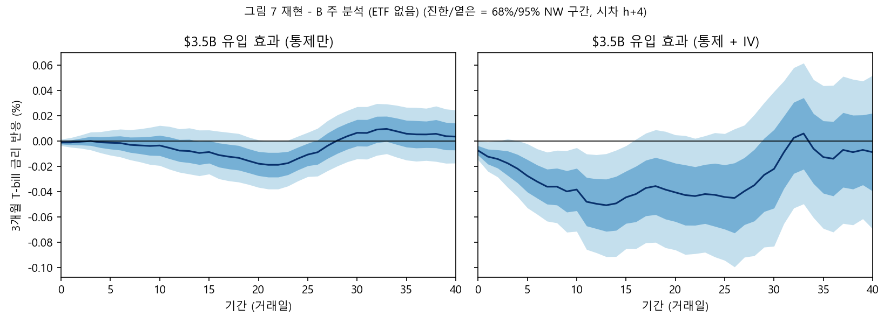

# 스테이블코인 유입과 미국 단기국채 금리

BIS 논문 **Ahmed & Aldasoro, "Stablecoins and safe asset prices"** (BIS Working Paper No 1270, 2026년 6월 개정판)를 **무료 자료로 재현**했습니다. 이어서 그 효과를 **실시간으로 예측·거래에 쓸 수 있는지** 검토하고, 미국 스테이블코인법 **GENIUS Act**에 주식시장과 국채시장이 어떻게 반응했는지 사건 연구로 살펴봤습니다.

- 한양대학교 비즈니스랩 퀀트랩 개인 연구 (2026년 2학기)
- 원 논문: https://www.bis.org/publ/work1270.htm

> 데이터와 보고서는 저장소에 포함하지 않았습니다. 코드, 결과 그림, 각 부의 설명 문서만 있습니다.

---

## 출발점

달러 스테이블코인 발행사는 받은 달러의 대부분을 미국 단기국채(T-bill)로 보관합니다. 원 논문은 스테이블코인으로 돈이 들어오면 발행사가 T-bill을 사들여 단기 금리가 내려간다는 것을 보였습니다. 핵심 결과는 **$3.5B 유입이 3개월 T-bill 금리를 당일 0.71bp, 13일째 약 5bp 낮춘다**는 것입니다.

효과가 하루에 끝나지 않고 13일에 걸쳐 커진다는 점에서 이 연구가 출발했습니다. 시장이 유입 정보를 천천히 반영한다면, 유입을 먼저 본 사람은 금리 변화를 미리 알 수 있을지 모릅니다.

---

## 다섯 부분과 결과

| 부 | 질문 | 결과 | 자세히 |
|---|---|---|---|
| **1부** 원 논문 재현 | 원 논문의 핵심 결과를 무료 자료로 재현할 수 있는가? 표본 이후에도 유지되는가? | **재현되고 유지됨.** 13일째 −5.08bp (원 논문 약 −5bp), 2026-10까지 늘려도 −5.09bp | [1부 문서](문서/1부_원논문재현.md) |
| **2부** 실시간 예측과 거래 | 그날 알 수 있는 정보만으로 만든 신호가 금리를 예측하는가? 돈이 되는가? | **관계는 있지만 예측·거래로 이어지지 않음.** 지난 자료 전체로 보면 신호 1표준편차당 −1.05bp (p 0.049). 하지만 매일 그날까지의 자료로 예측해 보면, 신호를 넣은 모형의 예측 오차가 신호 없는 모형보다 오히려 약 2% 큼 | [2부 문서](문서/2부_실시간예측과거래.md) |
| **3부** GENIUS Act 주가 | 법이 의회를 통과해 가는 날 발행사·거래소·은행·카드 주가는 어떻게 반응했는가? | **Coinbase +7.31% (p 0.002), Visa·Mastercard −2.52% (p <0.001).** 발행사·은행은 판단 불가. 단, 두 결과 모두 다른 뉴스(FOMC, 월마트·아마존 스테이블코인 보도)와 겹친 날에 몰려 있어, 그 날들을 빼면 유의하지 않음 | [3부 문서](문서/3부_GENIUS_주가사건연구.md) |
| **4부** GENIUS Act 국채 | 같은 날 단기국채 스프레드와 스테이블코인 유입은 반응했는가? | **원 논문 그림 6은 재현됨. GENIUS에는 스프레드(−0.28bp, p 0.88)도 유입(p 0.09)도 유의하지 않음.** 원 논문이 이 법을 뺀 판단과 맞음 | [4부 문서](문서/4부_GENIUS_국채사건연구.md) |
| **5부** 유입 베타 (미국·한국) | 평소 유입과 같이 움직이던 주식이 법안 소식에 더 크게 올랐는가? | **미국 −0.14% (p 0.82), 한국 −0.01% (p 0.98), 둘 다 성립 안 함** | [5부 문서](문서/5부_유입베타.md) |



### 종합

스테이블코인 유입이 단기국채 금리를 낮추는 관계는 **실재합니다**(1부). 하지만 효과가 작고 불안정해 **실시간 예측과 거래로는 이어지지 않습니다**(2부). 시장이 유입 정보를 "이용 가능할 만큼" 늦게 반영하지는 않는다는 뜻으로도 읽을 수 있습니다.

GENIUS Act가 나아간 날들에 거래소(Coinbase) 주가는 오르고 카드 네트워크(Visa, Mastercard) 주가는 내렸습니다(3부). 다만 이 반응은 FOMC 발표, 월마트·아마존의 스테이블코인 검토 보도와 겹친 날에 몰려 있어, 방향은 일관되지만 법안 소식만의 효과라고 단정하기는 어렵습니다. 반면 같은 날들에 스테이블코인 유입과 단기국채 스프레드는 유의하게 움직이지 않았습니다(4부). 평소 유입과 같이 움직이던 주식을 자료로 골라 봐도, 그 주식들이 더 크게 반응하지는 않았습니다(5부).

---

## 공통 원칙

- **결과를 보기 전에 설계를 고정합니다.** 2 ~ 5부는 각각 `_0.py` 코드가 사건, 모형, 판정 기준을 CSV로 저장하고, 저장할 때마다 시각을 기록 파일에 쌓습니다. 결과를 본 뒤 바꾸면 기록에 남습니다.
- **모든 설정 옆에 근거를 적었습니다.** 다음 네 가지 중 하나로 표시합니다.
  - `# 출처: 논문 ○○절 / 각주 ○` (논문 근거)
  - `# 출처: 저자 답신` (저자에게 이메일로 확인한 구현 방식)
  - `# 출처: 사용자 지시` / `사용자 확정 (날짜)` (연구자가 정한 조건)
  - `# [논문에 명시 없음]`
- **유의하지 않은 결과에는 최소 검출 효과를 같이 적습니다.** "효과가 없다"가 아니라 "이보다 큰 효과는 없다"로 읽기 위해서입니다.
- **결과를 본 뒤 한 분석은 "사후 분석"으로 표시하고 판정에 쓰지 않습니다.**

---

## 저장소 구조

```
README.md            이 문서 (전체 개요)
문서/                각 부의 자세한 설명 (설계, 결과 표, 그림, 한계, 실행 순서)
코드/                Spyder 셀(#%%) 단위로 실행하는 Python 코드
그림/                코드가 만든 결과 그림
```

| 부 | 코드 |
|---|---|
| 1부 | `퀀트랩_BIS_1.py` ~ `퀀트랩_BIS_4-1.py` |
| 2부 | `퀀트랩_거래전략_0.py` ~ `퀀트랩_거래전략_7.py` |
| 3부 | `퀀트랩_사건연구_0.py` ~ `퀀트랩_사건연구_5.py` |
| 4부 | `퀀트랩_국채사건_0.py` ~ `퀀트랩_국채사건_5.py` |
| 5부 | `퀀트랩_유입베타_0.py` ~ `퀀트랩_유입베타_4.py`, `퀀트랩_유입베타_한국_1.py` ~ `_2.py` |

각 부의 실행 순서와 코드별 설명은 해당 부 문서에 있습니다.

---

## 데이터

| 자료 | 출처 | 쓰는 부 | 비용 |
|---|---|---|---|
| 스테이블코인 코인×체인 시가총액 | DefiLlama | 1 ~ 5부 | 무료 (코드가 자동으로 받음) |
| 미국채 금리 | FRED | 1 · 2 · 4부 | 무료 (**API 키 필요**) |
| T-bill 입찰, 통제변수 | 미 재무부, FRED, Yahoo Finance | 1 · 2부 | 무료 (코드가 자동으로 받음) |
| 통화정책 충격 (FOMC 날짜) | SF 연준 USMPD | 1 · 2 · 4부 | 무료 (직접 받음) |
| 배제 조건 대체 자료 (ETF, OFR, Nasdaq 지수) | 운용사, OFR, Nasdaq | 1부 | 무료 (직접 받음) |
| 미국 주식 일별 | WRDS CRSP | 1부 (ETF 일부), 3부, 5부 | **구독 필요** |
| 한국 주식·지수 일별 | FnGuide DataGuide | 5부 (한국) | **구독 필요** |
| 법안 일정 | 미 의회 기록 (govinfo, S.1582) | 3 ~ 5부 | 무료 (설계표에 직접 적음) |

1 · 2부에서 원 논문의 유료 자료(CoinMarketCap, Token Terminal, Bloomberg, LSEG 등)는 무료 자료로 대체하거나 뺐습니다. 파일 이름과 받는 방법은 각 부 문서의 "자료" 절에 있습니다.

---

## 실행 방법

1. 폴더를 **바탕화면(Desktop)에 `스테이블코인_퀀트랩`** 이라는 이름으로 둡니다. 코드가 `Desktop/스테이블코인_퀀트랩/데이터`, `.../그림`에 읽고 씁니다.
2. 패키지: `pip install pandas numpy statsmodels scipy matplotlib requests yfinance openpyxl xlrd`
3. **FRED API 키** (https://fred.stlouisfed.org/docs/api/api_key.html 에서 무료 발급): `스테이블코인_퀀트랩/FRED_키.txt` 파일을 만들고 키를 한 줄로 넣습니다. 환경변수 `FRED_API_KEY`가 있으면 그것을 먼저 씁니다. 이 파일은 저장소에 올라가지 않습니다.
4. 각 부 문서의 "자료" 표에서 "직접 받음" 자료를 `데이터/` 폴더에 넣습니다.
5. Spyder에서 셀(`#%%`) 단위로 실행합니다. 앞 단계가 만든 파일을 뒤 단계가 읽으므로 **1부 → 5부, 각 부 안에서는 번호 순서**로 실행합니다. 3부 이후는 1부 확장(`퀀트랩_BIS_4-1.py`)과 3부 1단계(`퀀트랩_사건연구_1.py`)의 결과 파일을 씁니다.

---

## 참고문헌

- Ahmed, R. and I. Aldasoro (2025). Stablecoins and safe asset prices. BIS Working Papers No 1270 (2026년 6월 개정판)
- Gabaix, X. and R. S. J. Koijen (2024). Granular instrumental variables. Journal of Political Economy 132(7)
- Jordà, Ò. (2005). Estimation and inference of impulse responses by local projections. American Economic Review 95(1)
- Clark, T. E. and K. D. West (2007). Approximately normal tests for equal predictive accuracy in nested models. Journal of Econometrics 138(1)
- MacKinlay, A. C. (1997). Event studies in economics and finance. Journal of Economic Literature 35(1)
- Bloom, H. S. (1995). Minimum detectable effects: A simple way to report the statistical power of experimental designs. Evaluation Review 19(5)

각 부에서 쓴 나머지 문헌은 해당 부 문서에 있습니다.
