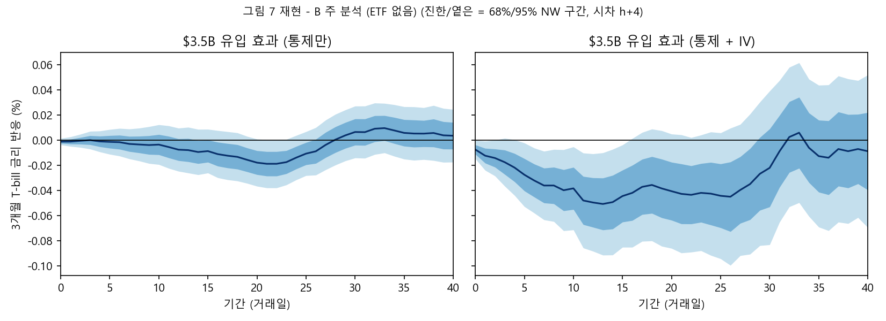
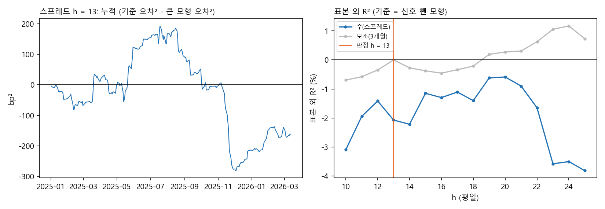
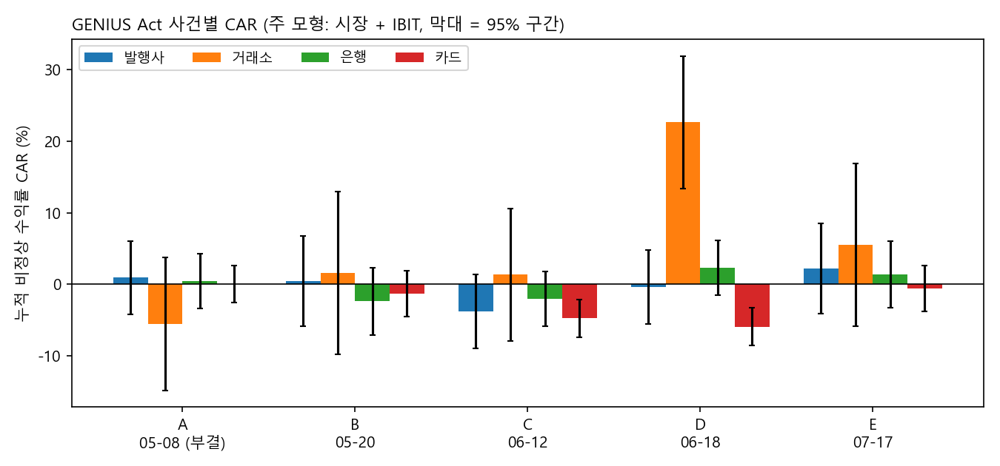

# 스테이블코인 유입과 미국 단기국채 금리

BIS 논문 **Ahmed & Aldasoro, "Stablecoins and safe asset prices"** (BIS Working Paper No 1270, 2026년 6월 개정판)를 **무료 자료로 재현**하고, 그 효과를 **그날 알 수 있는 정보만으로 예측하고 거래에 이용할 수 있는지** 검토한 뒤, 미국 스테이블코인법 **GENIUS Act에 주식시장이 어떻게 반응했는지** 사건 연구로 본 연구입니다.

- 한양대학교 비즈니스랩 퀀트랩 개인 연구 (2026년 2학기)
- 원 논문: https://www.bis.org/publ/work1270.htm

> 데이터와 보고서는 저장소에 포함하지 않았습니다. 코드와 결과 그림만 있습니다.

---

## 연구 질문

달러 스테이블코인 발행사는 받은 달러의 대부분을 미국 단기국채(T-bill)로 보관합니다. 원 논문은 스테이블코인으로 돈이 들어오면 발행사가 T-bill을 사들여 단기 금리가 내려간다는 것을 보였습니다. 핵심 결과는 **$3.5B 유입이 3개월 T-bill 금리를 당일 0.71bp, 13일째 약 5bp 낮춘다**는 것입니다.

효과가 하루에 끝나지 않고 13일에 걸쳐 커진다는 점에서 이 연구가 출발했습니다. 시장이 유입 정보를 천천히 반영한다면, 유입을 먼저 본 사람은 금리 변화를 미리 알 수 있을지 모릅니다.

1. **1부 재현:** 원 논문의 핵심 결과를 무료 자료로 재현할 수 있는가? 논문 표본 이후(2026년 4~10월)를 더해도 유지되는가?
2. **2부 실시간 활용:** 그날 알 수 있는 정보만으로 만든 신호가 이후 금리 변화를 예측하는가(예측이 되는가)? 거래비용을 빼고도 이익을 낼 수 있는가(돈이 되는가)?
3. **3부 법안 반응:** GENIUS Act가 의회를 통과해 가는 날들에 발행사, 거래소, 은행, 카드 네트워크의 주가가 어떻게 반응했는가?

2부와 3부의 모든 판정 기준은 **결과를 보기 전에 설계표로 고정**했습니다(`퀀트랩_거래전략_0.py`, `퀀트랩_사건연구_0.py`).

---

## 주요 결과

### 1부: 원 논문 재현 — 재현되고 유지됨

| | 원 논문 | 재현 (~2026-03-31) | 기간 확장 (~2026-10-02) |
|---|---|---|---|
| 1단계 회귀 (5일 유입 ← GIV 5일 합) | 계수 1.04, F 42.0 | 계수 0.974, F 34.5 | 계수 1.059, F 42.9 |
| 당일 3개월 금리 반응 ($3.5B 유입) | −0.71bp | −0.74bp (p 0.048) | −0.77bp (p 0.020) |
| 13일째 반응 (저점) | 약 −5bp | **−5.08bp** (p 0.015) | **−5.09bp** (p 0.006) |
| 모든 기간의 1단계 F ≥ 10 | — | 최소 30.9 | 최소 38.7 |

- **배제 조건** 네 가지 근거 중 세 가지는 원 논문과 같은 결론(분산 분해 6.5 / 61.3 / −3.6 / 35.8, 원 논문 6.3 / 61.7 / −3.6 / 35.5). 주성분 분석의 "약 16%"만 재현하지 못함
- GIV의 세부 설정(5일 합 방식, 윈저화 기준, 활성 페어 수 N의 정의)은 논문에 다 나와 있지 않아 72개 조합을 비교했고, 최종 설정은 저자에게 이메일로 문의해 확정함. 저자가 확인해 준 설정은 72개 중 원 논문 수치에 가장 가까운 조합과 같았음

### 2부: 실시간 활용 — 관계는 있지만 예측·거래로 이어지지 않음

결과변수: 3개월 − 6개월 금리 스프레드의 13 평일 변화. 신호: 그날까지의 자료로만 다시 계산한 실시간 GIV (2024년부터)

| 판정 | 질문 | 결과 | 판정 |
|---|---|---|---|
| A 검정력 | 효과가 있다면 잡을 수 있는가 | 70.8% | 조건부 진행 |
| B 표본 내 | 관계가 있는가 | 신호 1표준편차당 **−1.05bp**, p 0.049 | 성립 |
| C 표본 외 | 예측이 되는가 | 표본 외 R² **−2.07%**, Clark-West t 0.70 | **성립 안 함** |
| D 경제적 의미 | 돈이 되는가 | 비용 후 누적 1.78bp, 손익분기 호가 차이 0.951bp > 0.79bp | 형식상 성립, **신호 기여 없음** |
| 강건성 | 우연인가 | 위약 검정 −0.20bp (p 0.668) | 통과 |

- 만기 선택 전략의 이익은 신호의 타이밍이 아니라 이 기간 3개월물이 6개월물보다 유리했던 기간구조에서 나옴 (신호대로 갈아탄 날 평균 0.666bp vs 매일 갈아탔을 때 0.675bp)
- 실패 원인: 효과가 스프레드 변동에 비해 작고(R² 0.067), 신호를 쓸 수 있는 표본이 짧고(2024년부터), 관계가 시기마다 흔들림

### 3부: GENIUS Act 사건 연구 — Coinbase는 오르고 Visa·Mastercard는 내림

의회 기록의 본회의 표결 7번과 서명을 창이 겹치지 않게 묶은 사건 5개, 창 [0, +1], 모형은 시장 + 비트코인(IBIT). S = 법이 한 걸음 나아갈 때의 평균 누적 비정상 수익률(나쁜 소식인 사건 A는 부호를 뒤집음)

| 그룹 | 종목 | S | t | p | 최소 검출 효과 | 판정 |
|---|---|---|---|---|---|---|
| 발행사 | PYPL | −0.49% | −0.38 | 0.705 | 3.6% | 성립 안 함 (판단 불가) |
| 거래소 | COIN | **+7.31%** | 3.16 | 0.002 | 6.5% | **성립** |
| 은행 | KBE, KRE | −0.24% | −0.25 | 0.800 | 2.7% | 성립 안 함 (판단 불가) |
| 카드 | V, MA | **−2.52%** | −3.86 | <0.001 | 1.8% | **유의 (− 방향)** |

- 미리 정한 강건성 점검 네 가지에서 모든 그룹의 부호가 같았고, Coinbase와 카드는 모두 5%에서 유의함
- **사건 하나의 영향(사후 점검):** 카드는 어떤 사건을 빼도 유의함. Coinbase는 상원 통과(사건 D)를 빼면 +3.48%(p 0.189)로 유의하지 않아, 유의성은 주로 그 사건에서 나옴

**결론:** 스테이블코인 유입이 단기국채 금리를 낮추는 관계는 실재하지만, 효과가 작고 불안정해 실시간 예측과 거래로 이어지지 않는다. 시장이 유입 정보를 "이용 가능할 만큼" 늦게 반영하지는 않는다는 뜻으로도 읽을 수 있다. GENIUS Act 소식은 이틀 안에 주가에 반영됐고, 시장은 이를 거래소에는 호재로, 카드 네트워크에는 악재로 받아들였다. 은행 예금 유출 우려는 주가에 드러나지 않았지만, 작은 반응까지 배제할 수는 없다.

---

## 방법

**그래뉼러 도구변수(GIV, Gabaix & Koijen 2024).** 스테이블코인은 같은 코인도 여러 블록체인에서 따로 발행되며, 이 "코인×체인" 페어 단위로 보면 시장이 극도로 집중되어 있습니다(상위 3개 페어가 약 80%). 큰 페어 하나의 개별 사건은 상쇄되지 않고 전체 유입을 움직입니다. GIV는 각 페어의 성장률에서 시장 공통 움직임을 빼고, 큰 페어의 개별 충격에 가중치를 둔 합입니다.

GIV(t) = Σᵢ (sᵢ,ₜ₋₁ − 1/Nₜ) × εᵢ,ₜ,  εᵢ,ₜ = gᵢ,ₜ − Σⱼ sⱼ,ₜ₋₁ gⱼ,ₜ

(g = 페어의 하루 시가총액 성장률, s = 전날 점유율, N = 활성 페어 수)

**금리 반응.** 국소 투영(Jordà 2005)으로 h = 0 ~ 40 거래일 뒤까지의 3개월 금리 변화를 5일 유입에 회귀하고, 유입을 GIV로 도구합니다. 표준오차는 Newey-West 시차 h + 4.

**2부 원칙.** ① 모든 변수는 그날 이미 알 수 있는 것만 쓰고(DefiLlama 값 확정 시각이 불확실해 하루 지연), ② 판정 기준은 금리 결과를 보기 전에 정합니다. 표본 외 예측은 확장창으로 매일 다시 추정하고, 신호만 뺀 같은 모형과 비교합니다(Clark & West 2007).

**3부 사건 연구.** 평소 움직임은 2024-04-24 ~ 2025-04-23의 250거래일로 추정합니다. 비정상 수익률 = 실제 수익률 − (a + b × 시장 + c × IBIT)이고, 그룹마다 동일가중 포트폴리오 하나로 검정합니다(MacKinlay 1997).

---

## 데이터

| 자료 | 출처 | 받는 방법 |
|---|---|---|
| 스테이블코인 코인×체인 시가총액 | DefiLlama (stablecoins.llama.fi) | 코드가 자동으로 받음 |
| 미국채 금리 (1개월 ~ 10년) | FRED | 코드가 자동으로 받음 (**FRED API 키 필요**) |
| 13주물 T-bill 입찰 | 미 재무부 Fiscal Data API | 코드가 자동으로 받음 |
| 기타 통제변수 | FRED, Yahoo Finance | 코드가 자동으로 받음 |
| 통화정책 충격 | SF 연준 USMPD (https://sffed.us/USMPD) | 직접 받아 `데이터/통화정책충격_USMPD.xlsx`, 최신본은 `데이터/확장_통화정책충격_USMPD.xlsx`로 저장 |

배제 조건 대체 자료 분석(`퀀트랩_BIS_3-1.py`)에만 추가로 필요한 자료:

| 자료 | 출처 | 저장 이름 |
|---|---|---|
| ETF 일별 발행주식수 (BIL, SPTS) | SPDR NAV History | `ETF_BIL_운용사.xlsx`, `ETF_SPTS_운용사.xlsx` |
| ETF 일별 발행주식수 (SGOV) | iShares Data Download | `ETF_SGOV_운용사.xls` |
| ETF 일별 (SHV, SHY, VGSH, SCHO) | WRDS CRSP (**구독 필요**) | `ETF_CRSP_일별.csv` |
| 금융스트레스지수 | OFR Financial Stress Index | `OFR_금융스트레스지수.csv` |
| 암호자산 지수 | Nasdaq Crypto Index (Nasdaq 지수 사이트) | `암호자산지수_NCI_나스닥.xlsx` |

3부 사건 연구(`퀀트랩_사건연구_1~5.py`)에 필요한 자료:

| 자료 | 출처 | 저장 이름 |
|---|---|---|
| 8종목·ETF 일별 주식 자료 | WRDS CRSP Stock - Version 2, Daily Stock File (**구독 필요**) | `사건연구_CRSP_일별.csv` |
| 가치가중 시장지수 | WRDS CRSP Stock - Version 2, Daily Stock Market Indexes (**구독 필요**) | `사건연구_CRSP_시장지수.csv` |

법안 일정은 미 의회 기록(govinfo, S.1582)에서 옮겨 `퀀트랩_사건연구_0.py`의 설계표에 적어 두었습니다.

1·2부에서 원 논문의 유료 자료(CoinMarketCap, Token Terminal, Bloomberg, LSEG 등)는 무료 자료로 대체하거나 뺐습니다. 1부 표본은 원 논문과 같은 2021-01-04 ~ 2026-03-31 평일 1,367일, 기간 확장은 2026-10-02까지(1,500일)입니다.

---

## 실행 방법

### 준비
1. 폴더를 **바탕화면(Desktop)에 `스테이블코인_퀀트랩`** 이라는 이름으로 둡니다. 코드가 `Desktop/스테이블코인_퀀트랩/데이터`, `.../그림`에 읽고 씁니다.
2. 패키지: `pip install pandas numpy statsmodels scipy matplotlib requests yfinance openpyxl xlrd`
3. **FRED API 키** (https://fred.stlouisfed.org/docs/api/api_key.html 에서 무료 발급): `스테이블코인_퀀트랩/FRED_키.txt` 파일을 만들고 키를 한 줄로 넣습니다. 환경변수 `FRED_API_KEY`가 있으면 그것을 먼저 씁니다. 이 파일은 저장소에 올라가지 않습니다.
4. 위 표의 "직접 받는" 자료를 `데이터/` 폴더에 넣습니다.

### 순서
Spyder에서 셀(`#%%`) 단위로 실행하도록 만들었습니다. 앞 단계가 만든 파일을 뒤 단계가 읽으므로 순서대로 실행합니다.

| 코드 | 하는 일 |
|---|---|
| `퀀트랩_BIS_1.py` | 데이터 수집 + 그림 2, 3 재현 |
| `퀀트랩_BIS_2.py` | GIV 구성 + 표 2 (3)열 1단계 회귀 재현 |
| `퀀트랩_BIS_3.py` | 배제 조건 네 가지 근거 점검 (논문과 같은 무료 변수) |
| `퀀트랩_BIS_3-1.py` | 배제 조건 ④ 대체 자료 분석 (위 추가 자료 필요) |
| `퀀트랩_BIS_4.py` | 3개월 금리 반응 (그림 7) 재현 |
| `퀀트랩_BIS_4-1.py` | 기간 확장 (2026-10까지) |
| `퀀트랩_거래전략_0.py` | 설계 확정 (결과를 보기 전에 판정 기준을 파일로 남김) |
| `퀀트랩_거래전략_1.py` | 실시간 GIV (그날까지의 자료로만 다시 계산) |
| `퀀트랩_거래전략_2.py` | 검정력 점검 (판정 A) |
| `퀀트랩_거래전략_3.py` | 표본 내 예측 회귀 (판정 B) |
| `퀀트랩_거래전략_4.py` | 표본 외 예측 (판정 C) |
| `퀀트랩_거래전략_5.py` | 만기 선택 전략 백테스트 (판정 D) |
| `퀀트랩_거래전략_6.py` | 강건성 점검 |
| `퀀트랩_거래전략_6-1.py` | 사후 분석: 신호 시작 시점 |
| `퀀트랩_거래전략_7.py` | 진짜 표본 외 (설계 이후 생긴 2026년 4~9월 자료) |
| `퀀트랩_사건연구_0.py` | 3부 설계 확정 (결과를 보기 전에 사건과 판정 기준을 파일로 남김) |
| `퀀트랩_사건연구_1.py` | CRSP 자료 정리, 사건 창과 추정 기간 확정 |
| `퀀트랩_사건연구_2.py` | 검정력 (사건 창을 보기 전 최소 검출 효과) |
| `퀀트랩_사건연구_3.py` | 본 분석: 사건별 CAR과 주 판정 |
| `퀀트랩_사건연구_4.py` | 강건성 점검 + Circle(CRCL) 참고 |
| `퀀트랩_사건연구_5.py` | 사후 분석: 사건 하나씩 빼 보기 |

코드의 모든 설정 옆에는 근거를 적었습니다: `# 출처: 논문 ○○절 / 각주 ○` (논문 근거), `# 출처: 저자 답신` (저자에게 이메일로 확인한 구현 방식), `# 출처: 사용자 지시` (연구자가 정한 조건), `# [논문에 명시 없음]`.

---

## 한계

- **짧은 표본:** 2부 판정 표본은 2024년 ~ 2026년 3월(496일), 표본 외 예측은 약 15개월
- **비용 가정:** 거래비용은 1996~2000년 딜러 간 호가(Fleming 2003). 실제 고객 비용은 더 클 수 있음
- **하나의 예측 기간:** 판정은 h = 13 하나로만 함
- **대체 자료:** 통화정책 충격은 대체 자료, MMF 유입 등 일부 통제변수는 무료 자료가 없어 뺌
- **사건 수 (3부):** 사건이 5개뿐이라 검정력이 제한됨. PayPal은 사건당 3.6%, 은행은 2.7%보다 작은 반응을 가려낼 수 없음
- **동시 뉴스 (3부):** 사건 창에 다른 뉴스가 섞일 수 있음. 또 그룹이 4개라 하나쯤은 우연히 유의할 수 있음
- **Circle (3부):** 2025년 6월 상장이라 추정 기간이 없고 상장 직후 급등과 섞여, 참고로만 봄
- **사후 분석**(신호 시작 시점, 보조 신호, 위험 조정, 사건 제외)은 결과를 본 뒤 한 분석이라 판정에 쓰지 않음

---

## 참고문헌

- Ahmed, R. and I. Aldasoro (2025). Stablecoins and safe asset prices. BIS Working Papers No 1270 (2026년 6월 개정판)
- Gabaix, X. and R. S. J. Koijen (2024). Granular instrumental variables. Journal of Political Economy 132(7)
- Jordà, Ò. (2005). Estimation and inference of impulse responses by local projections. American Economic Review 95(1)
- Clark, T. E. and K. D. West (2007). Approximately normal tests for equal predictive accuracy in nested models. Journal of Econometrics 138(1)
- Campbell, J. Y. and S. B. Thompson (2008). Predicting excess stock returns out of sample. Review of Financial Studies 21(4)
- Goyal, A. and I. Welch (2008). A comprehensive look at the empirical performance of equity premium prediction. Review of Financial Studies 21(4)
- Fleming, M. J. (2003). Measuring Treasury market liquidity. FRBNY Economic Policy Review 9(3)
- Acosta, M., A. Ajello, M. Bauer, F. Loria and S. Miranda-Agrippino (2025). Financial market effects of FOMC communication. SF Fed Working Paper 2025-30
- MacKinlay, A. C. (1997). Event studies in economics and finance. Journal of Economic Literature 35(1)
- Bloom, H. S. (1995). Minimum detectable effects: A simple way to report the statistical power of experimental designs. Evaluation Review 19(5)
