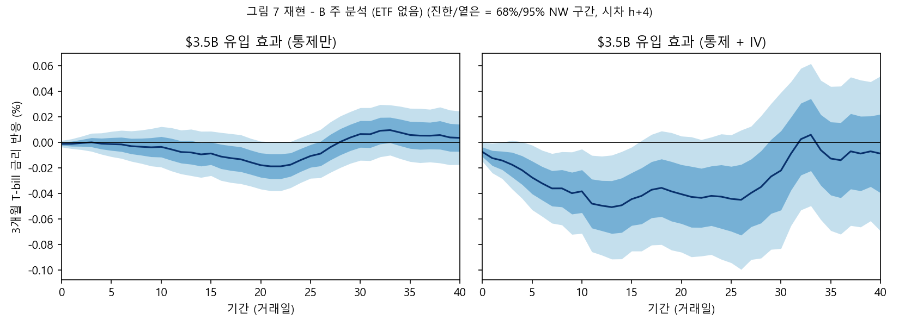
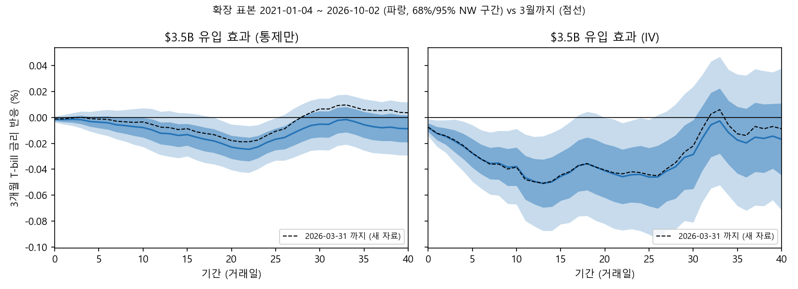
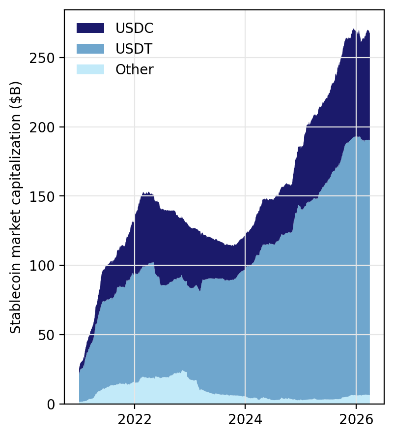
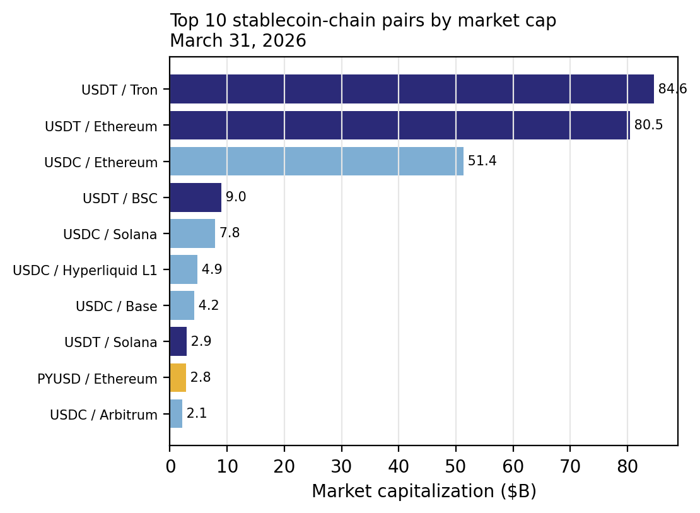
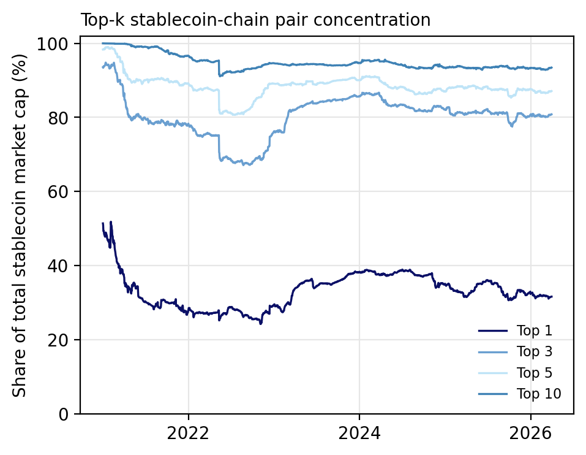
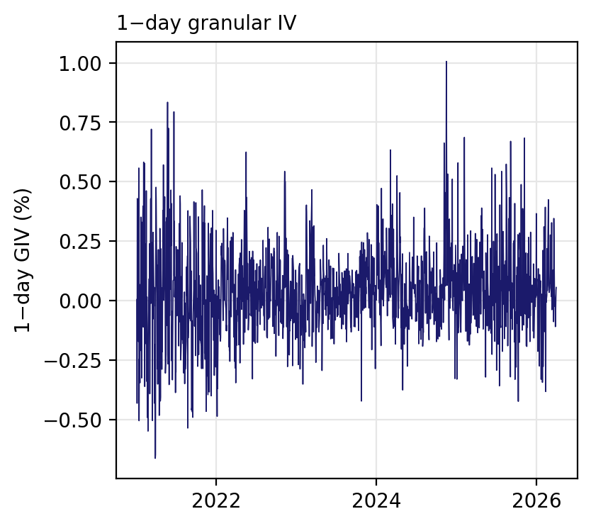
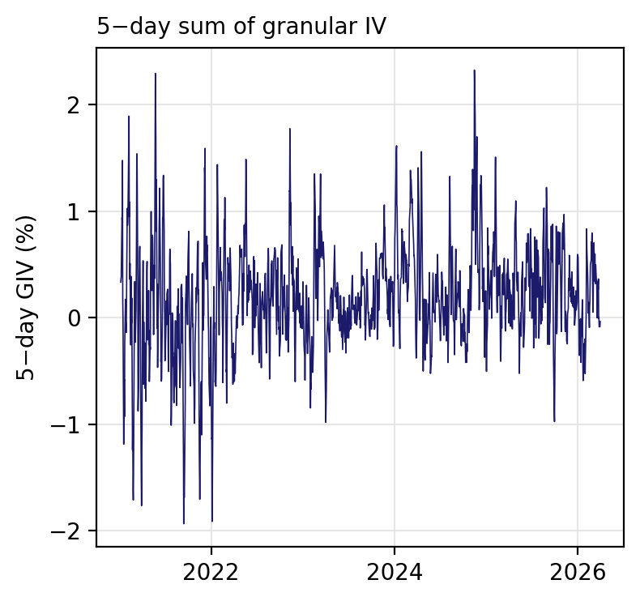

# 1부. 원 논문 재현: 스테이블코인 유입은 단기국채 금리를 낮추는가

[← 전체 개요로](../README.md) · 다음: [2부 실시간 예측과 거래 →](2부_실시간예측과거래.md)

---

## 질문

1. Ahmed & Aldasoro, "Stablecoins and safe asset prices" (BIS WP 1270, 2026년 6월 개정판)의 핵심 결과를 **무료 자료만으로** 재현할 수 있는가?
2. 논문 표본 이후(2026년 4월 ~ 10월)를 더해도 결과가 유지되는가?

원 논문의 핵심 결과: **$3.5B 유입이 3개월 T-bill 금리를 당일 0.71bp, 13거래일째 약 5bp 낮춘다.**

## 왜 이런 관계가 생기는가

달러 스테이블코인 발행사는 받은 달러 대부분을 미국 단기국채로 보관합니다. 스테이블코인으로 돈이 들어오면 발행사가 T-bill을 사야 하고, 그 수요가 단기 금리를 누릅니다.

문제는 **역인과와 공통 원인**입니다. 금리가 내려가서 돈이 스테이블코인으로 들어올 수도 있고, 위험 회피 같은 제3의 요인이 둘을 함께 움직일 수도 있습니다. 그래서 단순 회귀 대신 도구변수가 필요합니다.

## 방법

### IV와 GIV는 무엇이 다른가

- **IV (도구변수, instrumental variable)** 는 추정 **방법**의 이름입니다. 유입과 금리가 서로 영향을 주고받으면 그냥 회귀해서는 인과를 알 수 없습니다. 그래서 "유입은 움직이지만 금리와는 직접 관계없는 변수"(도구)를 찾아, **그 도구가 움직인 만큼의 유입만으로** 금리 반응을 잽니다.
- **GIV (그래뉼러 도구변수)** 는 그 **도구를 만드는 방법** 중 하나입니다(아래). 즉 GIV는 IV의 한 종류이고, 이 연구는 "GIV로 만든 도구를 써서 IV로 추정"했습니다.
- 결과 표와 그림의 **"IV"는 GIV를 도구로 쓴 추정**, **"통제만"은 도구 없이 통제변수만 넣고 그냥 회귀한 추정**입니다.

IV 추정은 두 단계로 이루어집니다. 1단계에서 실제 유입을 GIV에 회귀해 "GIV로 설명되는 유입"을 만들고, 2단계에서 그 유입으로 금리 변화를 설명합니다. **1단계 F**는 GIV가 실제 유입을 얼마나 강하게 움직이는지를 나타내며, 보통 10을 넘으면 도구가 충분히 강하다고 봅니다(관련성 조건).

### 유입의 정의

5일 유입 = 오늘의 스테이블코인 합산 시가총액 − 5거래일 전 합산 시가총액 ($B)

일주일 동안 들어온 돈입니다. 논문의 효과 크기 **$3.5B는 이 5일 유입의 약 2표준편차**입니다(원 논문 3.4절, 표준편차 1.74 $B). 본 연구 자료의 표준편차는 1.75 $B로 거의 같아, 논문과 같은 $3.5B로 환산했습니다.

### 그래뉼러 도구변수 (GIV, Gabaix & Koijen 2024)

스테이블코인은 같은 코인도 여러 블록체인에서 따로 발행됩니다. 이 "코인 × 체인" 페어 단위로 보면 시장이 극도로 집중되어 있습니다. USDT / Tron 하나가 약 3분의 1이고, 상위 3개 페어가 약 80%입니다. 그래서 큰 페어 하나의 개별 사건(체인 이전, 대량 발행·소각 등)은 상쇄되지 않고 전체 유입을 움직입니다.

GIV는 각 페어의 성장률에서 시장 공통 움직임을 빼고 남은 개별 충격을, 큰 페어에 가중치를 두어 더한 값입니다.

```
GIV(t) = Σᵢ (sᵢ,ₜ₋₁ − 1/Nₜ) × εᵢ,ₜ
εᵢ,ₜ  = gᵢ,ₜ − Σⱼ sⱼ,ₜ₋₁ gⱼ,ₜ

g = 페어의 하루 시가총액 성장률, s = 전날 점유율, N = 활성 페어 수
```

공통 충격은 구성상 빠지므로, 금리를 움직이는 거시 요인과는 관련이 없어야 합니다(배제 조건). 유입이 5일 단위이므로 도구도 최근 5일의 GIV를 더한 **GIV 5일 합**을 씁니다.

### 금리 반응: 국소 투영 (Jordà 2005)

h = 0 ~ 40 거래일마다 아래 회귀를 따로 추정합니다(원 논문 3.3절 식 (4)). 5일 유입은 GIV 5일 합으로 도구합니다.

```
y3M(t+h) − y3M(t−1) = α + β_h × 5일유입(t) + 통제변수 + 오차

y3M = 3개월 T-bill 금리, β_h = h일 뒤의 반응 (→ $3.5B 유입 기준 bp로 환산)
```

- 표준오차는 Newey-West, 시차 h + 4입니다. h일 뒤 변화와 5일 유입이 이웃 관측치끼리 겹치기 때문입니다. 원 논문은 이 시차를 밝히지 않아 직접 정했습니다.

### 통제변수

원 논문 식 (4)의 통제변수를 무료 자료로 최대한 그대로 넣었습니다.

| 구분 | 변수 | 비고 |
|---|---|---|
| 가까운 만기 금리 | FFR, 6개월, 1년 금리의 같은 기간(t−1 → t+h) 변화 | 3개월 금리만의 움직임을 보기 위함 |
| 3개월 금리의 지난 변화 | y3M(t−1) − y3M(t−5) | |
| 국채 공급 | 3개월 T-bill 입찰 금액, 입찰 있는 날 표시 | 미 재무부 |
| 통화정책 충격 | FOMC 발표 때의 금리 변화 | **대체:** 논문의 LSEG OIS 대신 SF 연준 USMPD |
| 금리 곡선 | FFR, 1개월·6개월·1년·2년·10년 금리의 5일 변화 | FRED |
| 위험·시장 | VIX, S&P 500, 금, 브렌트유, 달러 명목실효환율 (수준과 5일 변화) | |
| 암호자산 | 비트코인, 이더리움의 5일 변화 | |
| 연준·재무부 유동성 | 재무부 일반계정(TGA), 역레포(ON-RRP) (수준과 5일 변화) | FRED |
| **뺀 변수** | MMF 유입, 경기 서프라이즈 지수(CESI), 국채시장 여건지수(MCI) | 무료 자료 없음 (MCI는 BIS 내부 지수) |

논문 목록에 있는 "3개월 금리의 5일 변화"는 뺐습니다. "지난 변화"와 함께 넣으면 둘의 차이가 h = 0의 결과변수와 똑같아져, 당일 효과가 계산상 0이 되기 때문입니다. 원 논문은 당일 효과를 −0.71bp로 보고하므로, 실제 논문 사양에도 이 형태로는 없었던 것으로 봤습니다.

### GIV 세부 설정 확정

논문에 다 나와 있지 않은 설정 세 가지가 있습니다.

- 5일 합을 구하는 방식
- 윈저화 기준
- 활성 페어 수 N의 정의

이 셋의 조합 **72개를 모두 계산해 비교**했고(`GIV_72개_조합_비교`), 최종 설정은 **저자에게 이메일로 문의해 확정**했습니다. 저자가 확인해 준 설정은 72개 중 원 논문 수치에 가장 가까운 조합과 같았습니다.

| 설정 | 최종 (저자 확인) |
|---|---|
| 활성 페어 | 그날과 전날 모두 시가총액 100만 달러 초과 (원 논문 각주 18) |
| 윈저화 | 성장률을 0 ± 8 × 1.4826 × MAD로 자름. MAD는 전 기간 활성 페어의 성장률 전체로 한 번 계산 (중앙값 기준) |
| 활성 페어 수 N | 전날(t−1) 활성인 페어 수. N < 5인 날은 GIV를 정의하지 않음 |
| GIV 5일 합 | 주말을 포함한 최근 달력일 5개의 GIV 합 (저자 확인) |

### 재현 판정 규칙 (결과를 보기 전에 정함)

| 규칙 | 내용 |
|---|---|
| ① | h = 0 반응이 음수이고 5%에서 유의 |
| ② | 저점이 10 ~ 25일 사이에 있고 5%에서 유의 |
| ③ | 모든 기간에서 1단계 F ≥ 10 (약한 도구변수가 아님) |

세 규칙을 모두 충족하면 "재현됨"으로 판정합니다.

---

## 결과

### 핵심 결과: 재현되고, 기간을 늘려도 유지됨

| | 원 논문 | 재현 (~2026-03-31) | 기간 확장 (~2026-10-02) |
|---|---|---|---|
| 표본 (평일) | 2021-01-04 ~ 2026-03-31 | 1,367일 | 1,500일 |
| 1단계 회귀 (5일 유입 ← GIV 5일 합) | 계수 1.04, F 42.0 | 계수 0.974, F 34.5 | 계수 1.059, F 42.9 |
| 당일 3개월 금리 반응 ($3.5B) | −0.71bp | −0.74bp (p 0.048) | −0.77bp (p 0.020) |
| 13일째 반응 (저점) | 약 −5bp | **−5.08bp** (p 0.015) | **−5.09bp** (p 0.006) |
| 모든 기간의 1단계 F | — | 최소 30.9 | 최소 38.7 |
| 판정 | | **재현됨** (①②③ 충족) | **유지됨** (①②③ 충족) |

> **1단계 F가 두 개인 이유:** "1단계 회귀"의 F 34.5는 원 논문 표 2 (3)열을 재현한 값으로, 유입을 GIV에만 회귀했습니다(전체 표본, Newey-West 시차 1). "모든 기간의 1단계 F"는 금리 반응 회귀(h = 0 ~ 40) 하나하나 안에서 통제변수까지 넣고 잰 1단계 F 중 가장 작은 값입니다(시차 4). 재현 판정 ③은 이 값으로 했습니다.



> **그림 읽는 법:** 세로축 단위는 **%** 입니다(−0.05 = −5bp). 가로축은 유입 뒤 거래일, 진한 띠와 옅은 띠는 68%·95% 신뢰구간입니다. 왼쪽은 **통제만**, 오른쪽은 **GIV를 도구로 쓴 IV** 추정입니다.

### 왜 IV가 필요한가: 통제만 vs IV

| $3.5B 유입 | 당일 (h = 0) | 13일째 | 20일째 |
|---|---|---|---|
| 통제만 | −0.11bp (p 0.40) | −0.79bp (p 0.40) | −1.78bp (p 0.06) |
| IV (GIV 도구) | **−0.74bp** (p 0.048) | **−5.08bp** (p 0.015) | −4.06bp (p 0.08) |

통제만 넣고 그냥 회귀하면 반응이 작고 유의하지 않습니다. 원 논문도 같은 모양을 보고합니다(10일 안에 1bp 미만, 20일째 약 −1.5bp). 이 추정에는 역인과와 공통 원인이 섞여 있어 유입의 효과만 따로 볼 수 없습니다. GIV로 금리와 무관한 유입만 골라내면 효과가 훨씬 뚜렷해집니다.

### 기간 확장: 2026년 4월 이후에 효과가 달라졌는가

기간 확장 자료에서 2026년 4월 전후의 반응 차이를 따로 검정했습니다.

| h | 차이 | p | 최소 검출 차이 |
|---|---|---|---|
| 0 | −0.43bp | 0.609 | 2.3bp |
| 13 | +0.32bp | 0.944 | 12.8bp |

차이는 유의하지 않습니다. 다만 추가 기간이 6개월뿐이라, 13일째 기준으로 12.8bp보다 작은 변화는 이 자료로 판단할 수 없습니다.




### 배제 조건: GIV가 금리를 움직이는 다른 요인과 무관한가

원 논문의 근거 네 가지를 모두 점검했습니다.

| 근거 | 본 연구 결과 | 원 논문과 비교 |
|---|---|---|
| ① 구성상 직교 | 공통 충격을 넣은 뒤 GIV 변화 최대 1.2e-15 | 성립 |
| ② 주성분 분석 | 설정 8개 중 5개에서 첫 주성분 설명 비율 2.0 ~ 20.4%. 나머지 3개(33 ~ 48%)는 페어 하나의 움직임이 결과를 좌우해 비교에서 뺌 | 논문의 "약 16%"는 **재현 못 함** |
| ③ 분산 분해 | 6.5 / 61.3 / −3.6 / 35.8 | 논문 표 7 (6.3 / 61.7 / −3.6 / 35.5)과 최대 0.4%p 차이 |
| ④ 교란변수 상관 | 무료 변수 6개 \|ρ\| 최대 0.065, 부호 12/12 일치 | 논문 기준(\|ρ\| ≤ 0.10) 충족 |

② 주성분 분석은 페어들이 하나의 공통 요인을 따라 같이 움직이는 정도를 봅니다. 이 값이 크면 그 공통 요인이 GIV에 섞일 수 있습니다. 설정 8개는 윈저화 여부 × 빈 값 처리(0 채움 / 균형 패널) × 행렬(공분산 / 상관)의 조합입니다. 값이 큰 3개는 TUSD/Ethereum, USDC/Polygon, USDT/BSC 중 한 페어가 결과를 좌우한 경우라, 공통 요인이라 보기 어려워 뺐습니다.

③ 분산 분해의 네 값은 각각 다음 몫입니다.

| 구성요소 | 본 연구 | 논문 표 7 |
|---|---|---|
| 코인 쪽 Var(α) | 6.5% | 6.3% |
| 체인 쪽 Var(β) | 61.3% | 61.7% |
| 공분산 2Cov(α, β) | −3.6% | −3.6% |
| 페어 고유 Var(u) | 35.8% | 35.5% |

시장 집중의 대부분이 코인이 아니라 **체인 쪽**에서 나온다는 원 논문의 결론이 그대로 나옵니다.

④의 무료 변수 6개는 VIX, S&P 500, 브렌트유, 달러 명목실효환율, 비트코인, 이더리움입니다. 원 논문의 유료 변수는 무료 대체 자료로 따로 점검했습니다(`퀀트랩_BIS_3-1.py`).

| 대체 자료 | 5일 기준 ρ | 비고 |
|---|---|---|
| 금 | 0.062 | 원 논문 +0.035 |
| 암호자산 지수 (Nasdaq NCI) | −0.051 | 원 논문 −0.070 |
| 단기국채 ETF 유입 7개 (운용사 + CRSP) | 0.055 | 원 논문 +0.097 |
| OFR 금융스트레스지수 | −0.016 | 원 논문 (Bloomberg / GS) −0.036 / −0.039 |

모든 대체 자료에서 |ρ|가 0.10보다 작았습니다.

### 추가 점검

**① 자료가 논문과 같은가**

무료 자료(DefiLlama)만으로 만든 패널이 논문과 얼마나 같은지 확인했습니다. 원 논문 표 2 (3)열에 DefiLlama만 쓴 결과가 따로 있어 그것과 비교했습니다. 활성 페어는 그날과 전날 모두 시가총액이 100만 달러를 넘는 페어입니다.

| 항목 | 본 연구 | 원 논문 |
|---|---|---|
| 코인×체인 페어 수 | 226 | 226 |
| 체인 수 | 117 | 117 |
| 활성 페어-일 | 165,499 | 166,019 |
| 거래일 수 | 1,367 | 1,367 |
| 상위 10개 페어 | 9개 일치 | — |

다른 한 페어는 USDC/Arbitrum(본 연구 2.1 $B, 논문 5.9 $B)입니다. 원 논문 부록에서 DefiLlama 자료 오류를 발견하고 유료 자료로 바꿨다고 밝힌 페어입니다.

**② 단기국채 ETF 유입을 통제에 넣어도 같은가**

원 논문은 단기국채 ETF 유입도 통제합니다. 이 자료는 일부가 유료(WRDS CRSP)라서 주 분석에서는 빼고, 넣은 사양을 비교로 따로 추정했습니다(ETF 자료가 있는 2025년 말까지).

| $3.5B 유입, IV | 당일 | 13일째 |
|---|---|---|
| 주 분석 (ETF 없음, ~2026.3) | −0.74bp (p 0.048) | −5.08bp (p 0.015) |
| 비교 (ETF 포함, ~2025.12) | −0.76bp (p 0.082) | −5.24bp (p 0.025) |

크기는 거의 같습니다.


**③ 유입이 생기기 전의 금리 변화까지 설명하지는 않는가 (사전 추세)**

GIV가 유입을 거치지 않고 금리 쪽 사정과 얽혀 있다면, 유입 **이전**의 금리 변화도 설명할 것입니다(Stock & Watson 2018). 그래서 같은 IV 회귀로 유입 1 ~ 4주 전의 3개월 금리 5일 변화를 설명해 봤습니다. 원 논문에는 없는 점검이라 기록용으로만 하고 판정에는 쓰지 않았습니다.

| $3.5B 유입 기준 | 1주 전 | 2주 전 | 3주 전 | 4주 전 |
|---|---|---|---|---|
| 통제 없음 | −2.11bp (p 0.21) | −2.01bp (p 0.20) | +3.51bp (p 0.16) | +1.61bp (p 0.52) |
| 통제 있음 | −1.05bp (p 0.44) | −1.43bp (p 0.29) | **+3.21bp (p 0.045)** | +2.52bp (p 0.12) |

8칸 중 1칸(통제 있음, 3주 전)이 5%에서 유의합니다. 8번 검정하면 우연히 하나쯤 유의할 수 있는 수준입니다. 다만 유입 전에 금리가 올랐다가 되돌아오는 움직임이 유입 효과의 일부로 잡혔을 가능성은 이 점검만으로 배제할 수 없어, 한계로 남겨 둡니다.

---

## 1부 결론

- 원 논문의 핵심 결과(당일 약 −0.7bp, 13일째 약 −5bp)는 무료 자료로 **재현되고**, 2026년 10월까지 늘려도 **유지됩니다**.
- 배제 조건 근거 네 가지 중 세 가지는 원 논문과 같은 결론입니다. 주성분 분석의 "약 16%"만 재현하지 못했습니다.
- 효과가 하루에 끝나지 않고 13일에 걸쳐 커진다는 점이 2부의 출발점입니다. 시장이 유입 정보를 천천히 반영한다면, 유입을 먼저 본 사람은 금리 변화를 미리 알 수 있을지 모릅니다.

## 한계

- 원 논문의 유료 자료(CoinMarketCap, Token Terminal, Bloomberg, LSEG 등)는 무료 자료로 바꾸거나 뺐습니다. 스테이블코인 시가총액은 CoinMarketCap 대신 DefiLlama를 썼습니다.
- 통화정책 충격은 SF 연준 USMPD를 대체 자료로 썼습니다. MMF 유입, CESI, MCI는 무료 자료가 없어 뺐습니다(통제변수 표 참고). 통제변수가 논문과 다르므로 효과의 **크기**는 판정에 넣지 않고 방향·유의성·저점 위치로만 판정했습니다.
- 사전 추세 점검에서 8칸 중 1칸(3주 전, +3.21bp)이 5%에서 유의했습니다. 유입 전 금리 움직임이 되돌아오는 몫이 효과에 섞였을 가능성을 완전히 배제하지 못합니다(추가 점검 ③).
- ETF 일별 자료 일부(SHV, SHY, VGSH, SCHO)는 WRDS CRSP 구독 자료입니다.

---

## 자료

| 자료 | 출처 | 받는 방법 |
|---|---|---|
| 스테이블코인 코인×체인 시가총액 | DefiLlama (stablecoins.llama.fi) | 코드가 자동으로 받음 |
| 미국채 금리 (1개월 ~ 10년) | FRED | 코드가 자동으로 받음 (**FRED API 키 필요**) |
| 13주물 T-bill 입찰 | 미 재무부 Fiscal Data API | 코드가 자동으로 받음 |
| 기타 통제변수 | FRED, Yahoo Finance | 코드가 자동으로 받음 |
| 통화정책 충격 | SF 연준 USMPD (https://sffed.us/USMPD) | 직접 받아 `데이터/통화정책충격_USMPD.xlsx`, 최신본은 `데이터/확장_통화정책충격_USMPD.xlsx`로 저장 |

배제 조건 대체 자료 분석(`퀀트랩_BIS_3-1.py`)에만 필요한 자료:

| 자료 | 출처 | 저장 이름 |
|---|---|---|
| ETF 일별 발행주식수 (BIL, SPTS) | SPDR NAV History | `ETF_BIL_운용사.xlsx`, `ETF_SPTS_운용사.xlsx` |
| ETF 일별 발행주식수 (SGOV) | iShares Data Download | `ETF_SGOV_운용사.xls` |
| ETF 일별 (SHV, SHY, VGSH, SCHO) | WRDS CRSP (**구독 필요**) | `ETF_CRSP_일별.csv` |
| 금융스트레스지수 | OFR Financial Stress Index | `OFR_금융스트레스지수.csv` |
| 암호자산 지수 | Nasdaq Crypto Index (Nasdaq 지수 사이트) | `암호자산지수_NCI_나스닥.xlsx` |

## 코드 (실행 순서)

| 코드 | 하는 일 | 그림 |
|---|---|---|
| [`퀀트랩_BIS_1.py`](../코드/퀀트랩_BIS_1.py) | 데이터 수집 + 논문 그림 2, 3 재현 | 그림2-1, 2-2, 3-1, 3-2 |
| [`퀀트랩_BIS_2.py`](../코드/퀀트랩_BIS_2.py) | GIV 구성 + 표 2 (3)열 1단계 회귀 재현 | 그림4-1, 4-2 |
| [`퀀트랩_BIS_3.py`](../코드/퀀트랩_BIS_3.py) | 배제 조건 네 가지 근거 점검 (무료 변수) | |
| [`퀀트랩_BIS_3-1.py`](../코드/퀀트랩_BIS_3-1.py) | 배제 조건 ④ 대체 자료 분석 | |
| [`퀀트랩_BIS_4.py`](../코드/퀀트랩_BIS_4.py) | 3개월 금리 반응 (논문 그림 7) 재현 | 그림7_재현_3개월금리, 그림7_재현_ETF포함비교 |
| [`퀀트랩_BIS_4-1.py`](../코드/퀀트랩_BIS_4-1.py) | 기간 확장 (2026-10까지) | 확장_그림7_전체기간, 확장_그림7_4월전후 |

## 그 밖의 그림

| 그림 | 내용 |
|---|---|
|  | 논문 그림 2 왼쪽: 달러 스테이블코인 합산 시가총액 (USDT, USDC, 기타) |
|  | 논문 그림 2 오른쪽: 만기별 미국채 금리 |
|  | 논문 그림 3 왼쪽: 시가총액 상위 10개 코인×체인 페어 |
|  | 논문 그림 3 오른쪽: 상위 k개 페어의 점유율 (집중도) |
|  | 논문 그림 4 왼쪽: 하루 GIV |
|  | 논문 그림 4 오른쪽: GIV 5일 합 |

## 참고문헌

- Ahmed, R. and I. Aldasoro (2025). Stablecoins and safe asset prices. BIS Working Papers No 1270 (2026년 6월 개정판)
- Gabaix, X. and R. S. J. Koijen (2024). Granular instrumental variables. Journal of Political Economy 132(7)
- Jordà, Ò. (2005). Estimation and inference of impulse responses by local projections. American Economic Review 95(1)
- Stock, J. H. and M. W. Watson (2018). Identification and estimation of dynamic causal effects in macroeconomics using external instruments. Economic Journal 128(610)
