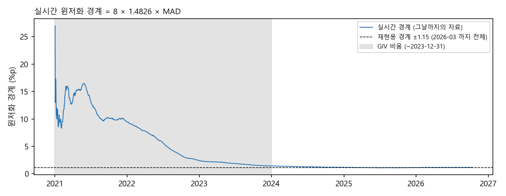
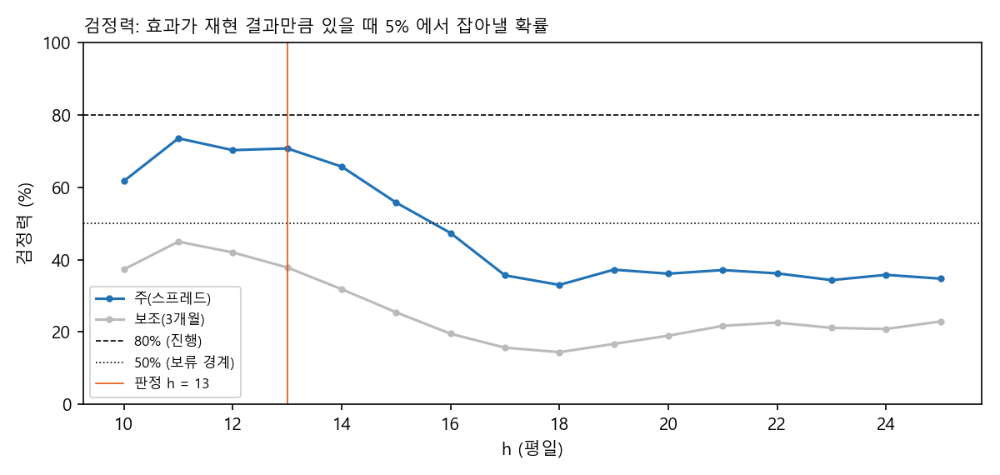
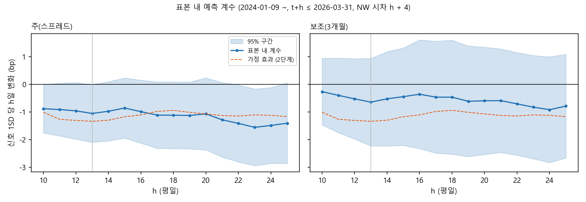
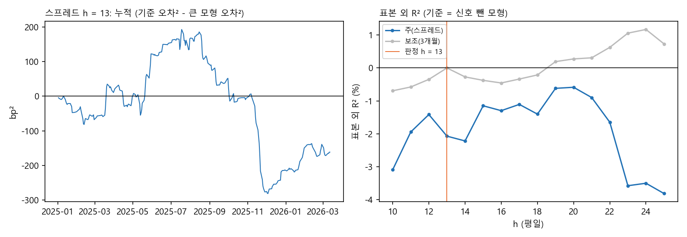
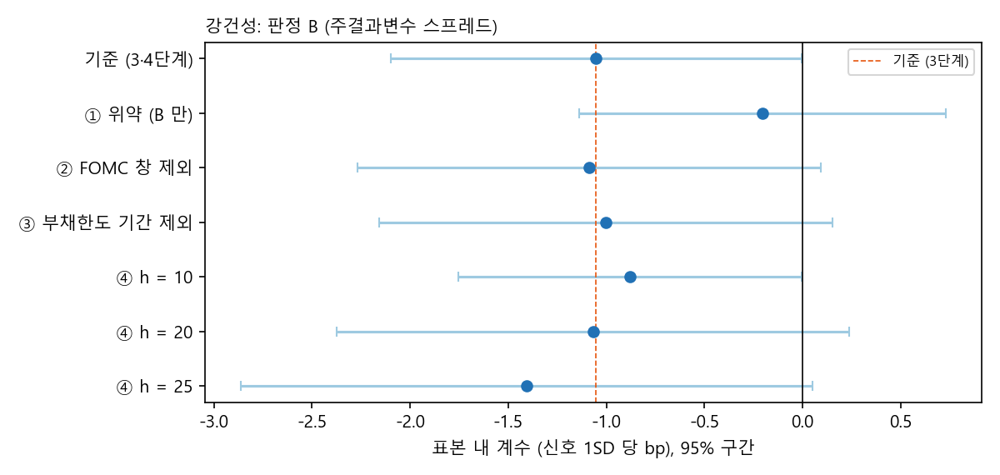

# 2부. 실시간 활용: 유입 신호로 금리를 예측하고 거래할 수 있는가

[← 1부 원 논문 재현](1부_원논문재현.md) · [전체 개요](../README.md) · 다음: [3부 GENIUS Act 주가 사건 연구 →](3부_GENIUS_주가사건연구.md)

---

## 질문

1부에서 유입 효과는 하루에 끝나지 않고 13거래일에 걸쳐 커졌습니다. 시장이 유입 정보를 천천히 반영한다면 다음과 같은 질문을 할 수 있습니다.

> **그날 알 수 있는 정보만으로 만든 신호가 이후 13일의 금리 변화를 예측하는가? 거래비용을 빼고도 이익을 낼 수 있는가?**

1부의 회귀는 전체 표본을 한 번에 써서 GIV를 만듭니다. 그래서 실제로 그날 거래하는 사람은 알 수 없었던 정보가 섞여 있습니다. 2부는 이 부분을 모두 걷어 냅니다.

## 원칙

1. **그날 알 수 있는 것만 씁니다.** GIV는 그날까지의 자료로만 매일 다시 계산합니다(실시간 GIV). DefiLlama 값이 확정되는 시각이 불확실해 하루를 늦춰 씁니다.
2. **판정 기준은 금리 결과를 보기 전에 정합니다.** `퀀트랩_거래전략_0.py`가 설계와 판정 기준을 CSV로 남기고, 저장할 때마다 시각을 기록 파일에 쌓습니다. 결과를 본 뒤 값을 바꾸면 기록에 남습니다.
3. **결과를 본 뒤 한 분석은 판정에 쓰지 않습니다.** "사후 분석"으로 따로 표시합니다.
4. **이전 시도도 기록합니다.** 이 설계 전에 스프레드 예측을 한 번 실행했으나, 결과를 검토하지 않고 폐기했습니다. 설계가 이전 결과의 영향을 받았는지 판단할 수 있도록 설계 기록에 남겼습니다.

## 설계

| 항목 | 내용 |
|---|---|
| 결과변수 | 3개월 − 6개월 금리 스프레드의 13 평일 변화 (bp). t일 금리로 사서 13평일 뒤까지 보유한 기간의 변화 |
| 신호 | 실시간 GIV 5일 합. 하루 늦춰 씀(t일 거래에는 직전 달력일 값, 월요일이면 일요일 값) |
| 신호를 쓰는 기간 | 2024년부터 (아래 설명) |
| 판정 표본 | 2024년 ~ 2026년 3월 (496일) |
| 표본 외 예측 | 2025-01 ~ 2026-03 (271일), 아래 방법 |
| 비교 기준 | 신호만 뺀 같은 모형 (Clark & West 2007) |
| 거래 전략 | 만기 선택 (아래 규칙) |
| 거래비용 | 딜러 간 호가 차이: 3개월물 0.74bp, 6개월물 0.79bp (Fleming 2003) |

### 왜 3개월 금리가 아니라 스프레드인가

1부의 회귀는 3개월 금리 반응을 볼 때 FFR·6개월·1년 금리의 **같은 기간 미래 변화**를 통제합니다. 그런데 예측할 때는 미래 값을 알 수 없어 이 통제를 쓸 수 없습니다. 그래서 그 역할을 하도록 6개월 금리를 빼서, 3개월물만의 상대적 움직임을 보는 스프레드(원 논문 3.2절과 같은 3개월 − 6개월)를 결과변수로 삼았습니다. 3개월 금리 변화는 보조 결과변수로만 봅니다.

### 왜 신호를 2024년부터 쓰는가

GIV가 실제 유입을 움직이는 정도(1단계: 5일 유입 ← GIV 5일 합)가 해마다 달랐습니다. 신호로 쓰려면 계수가 양수이고 F가 10 이상이어야 합니다(관련성 조건, Staiger & Stock 1997).

| 연도 | 2021 | 2022 | 2023 | 2024 | 2025 | 2026 |
|---|---|---|---|---|---|---|
| 계수 (논문 방식 GIV) | +1.00 | −0.43 | +0.42 | +2.04 | +1.79 | +2.46 |
| F (논문 방식 GIV) | 26.8 | 1.0 | 5.3 | **88.8** | **21.5** | **51.1** |
| 계수 (실시간 GIV) | | | | +1.99 | +1.83 | +2.48 |
| F (실시간 GIV) | | | | **85.3** | **21.4** | **52.2** |
| 기준 충족 | ○ | × (계수 음수) | × (F < 10) | ○ | ○ | ○ |

2021년은 기준을 넘지만, 2022년에 계수가 음수로 바뀌고 2023년에도 F가 10에 못 미쳐 관계가 끊깁니다. 2024년부터는 매년 F가 20을 넘게 다시 강해집니다. 그래서 **그 뒤로 계속 기준을 넘는 첫해인 2024년부터** 신호로 썼습니다. 실시간 GIV는 2024년부터만 계산했으므로(그 전은 비워 둠), 2023년까지는 논문 방식 GIV로 판단했습니다.

> 표의 숫자는 지금 저장된 자료로 다시 계산한 값입니다(Newey-West 시차 1, `퀀트랩_거래전략_1.py` [셀 9]와 같은 계산). 설계 당시 기록(`거래전략_설계.csv`)에는 2022년 계수가 논문 방식 −0.25, 실시간 −0.50으로, 2023년 실시간 계수가 0.46으로 남아 있습니다. 2022년 값이 조금 다른 것은 DefiLlama가 과거 값을 수정해 자료를 다시 받을 때마다 조금씩 달라지기 때문으로 보입니다. 기준 충족 여부는 어느 쪽 값으로 봐도 같습니다.

### 예측 회귀

```
스프레드(t+13) − 스프레드(t) = a + b × 신호(t) + 통제변수 + 오차
```

통제변수는 **t일에 이미 알 수 있는 것만** 넣었습니다. 1부의 미래 금리 통제는 예측에서 쓸 수 없어 뺐습니다.

| 통제변수 | 정의 | t일에 알 수 있는 이유 |
|---|---|---|
| 지난 5일 스프레드 변화 | 스프레드(t) − 스프레드(t−5) | 이미 지난 값 |
| FOMC | 결과 기간 (t, t+13] 안에 성명 발표일이 있으면 1 | 회의 일정은 미리 공개됨 |
| 입찰 | 발표일 ≤ t이고 발행일이 결과 기간 안인 13주물 입찰 금액 ($B) | 입찰은 발행 전에 발표됨 |

표준오차는 Newey-West, 시차 h + 4입니다.

### 표본 외 예측 방법

1. 2024년 자료로 처음 모형을 추정합니다.
2. 2025년 1월부터는 **매일 그날까지의 자료로 다시 추정**해 다음 13일을 예측합니다(확장창).
3. 추정에는 결과가 이미 알려진 관측치만 씁니다. t일 예측에는 13평일 뒤 결과까지 t일 이전에 끝난 관측치만 들어갑니다.
4. 같은 방법으로 신호만 뺀 모형도 예측해, 두 예측 오차를 비교합니다.

### 거래 전략 규칙

어차피 단기국채를 들고 있어야 하는 투자자(MMF 등)가 **만기만 바꾸는** 전략입니다.

- 평소에는 **6개월물**을 보유합니다.
- 예측한 스프레드 변화가 0보다 작으면(3개월물이 상대적으로 유리해질 것으로 예측) **3개월물로 바꿔 13일 보유**합니다.
- 자금을 13등분해 매일 1/13씩 결정하고, 공매도는 하지 않습니다.
- 갈아탈 때마다 거래 4번(6개월물 팔기, 3개월물 사기, 13일 뒤 반대로)에 각각 호가 차이의 절반을 비용으로 뺍니다.
- **손익분기 호가 차이 s\***: 비용을 뺀 누적 초과수익이 정확히 0이 되는 호가 차이입니다. s\*가 실제 호가 차이(문헌값 중 큰 0.79bp)보다 크면 비용을 견딘다고 봅니다.

### 판정 (결과를 보기 전에 정함)

| 판정 | 질문 | 기준 | 역할 |
|---|---|---|---|
| A 검정력 | 효과가 있다면 이 자료로 잡을 수 있는가 | 80% 이상 진행 / 50 ~ 80% 조건부 진행 / 50% 미만 보류 | 진행 여부 |
| B 표본 내 | 신호와 이후 스프레드 변화 사이에 관계가 있는가 | 계수 음수, 5% 유의 | **참고용** (논문이 효과를 찾은 표본이라 주 결론에 안 씀) |
| C 표본 외 | 예측이 되는가 (시장이 늦게 반영하는가) | 표본 외 R² > 0 (신호 없는 모형보다 예측 오차가 작음), Clark-West 한쪽 5% 유의 | **주 판정 ①** |
| D 경제적 의미 | 돈이 되는가 (비용 빼고 이용할 수 있는가) | 손익분기 호가 차이 s\* > 0.79bp | **주 판정 ②** |
| E 진짜 표본 외 | 설계 이후 새로 쌓인 자료에서도 같은가 | 짧아서 부호만 기록 | 확인용 |

검정력 A는 "1부에서 재현한 효과가 그대로 있다면, 예측 회귀의 계수는 얼마일까"를 1부 IV 계수와 실시간 1단계 계수로 계산하고, 그 크기를 이 표본에서 잡을 확률로 구합니다. 계수는 보지 않고 표준오차만으로 계산합니다.

---

## 결과

### 실시간 GIV는 1부 GIV와 거의 같음

| 점검 | 값 |
|---|---|
| 1부 GIV와의 상관 (2024.1 ~ 2026.10, 716일) | 0.9994 |
| 절대 차이 중앙값 / 최대 | 0.0047 / 0.099 |
| 1단계 F (실시간 GIV, 2024.1 ~ 2026.3) | 103.3 |

미래 정보를 걷어 내도 신호가 거의 바뀌지 않습니다. 실패한다면 신호 자체가 아니라 신호와 금리의 관계 쪽 문제입니다.

1부 GIV와 실시간 GIV의 차이는 윈저화 경계에 있습니다. 1부 GIV는 2026년까지의 자료 전체로 MAD를 한 번 구하므로 미래 정보가 섞이고, 실시간 GIV는 그날까지의 자료로 매일 다시 구합니다. 아래 그림은 실시간으로 구한 윈저화 경계가 시간에 따라 어떻게 변하는지 보여 줍니다(점선 = 1부의 고정 경계 ±1.15%p, 회색 = 신호를 쓰지 않는 2023년까지).



아래 그림은 두 GIV 5일 합을 겹쳐 그린 것입니다(왼쪽: 시간에 따른 값, 오른쪽: 같은 날 값끼리의 산점도).


### 판정 요약

| 판정 | 결과 | 판정 |
|---|---|---|
| A 검정력 | 70.8% | 조건부 진행 |
| B 표본 내 (참고) | 신호 1표준편차당 **−1.05bp**, p 0.049, R² 0.067 | 성립 |
| C 표본 외 (주 판정 ①) | 신호를 넣으면 예측 오차가 2.07% 커짐 (표본 외 R² **−2.07%**), Clark-West t 0.70 (p 0.243) | **성립 안 함** |
| D 경제적 의미 (주 판정 ②) | 비용 후 누적 1.78bp (연 1.44bp), 손익분기 호가 차이 0.951bp > 0.79bp | 형식상 성립, **신호 기여 없음** |
| E 진짜 표본 외 (확인용) | 표본 외 R² −0.52%, Clark-West t 0.38 | C와 같은 방향 |

주 판정 두 가지 중 C는 성립하지 않았고, D는 형식상 성립했지만 이익이 신호에서 나오지 않았습니다(아래).

### A 검정력: 70.8%

1부 효과가 그대로 있다면 이 표본에서 그것을 잡아낼 확률이 h = 13에서 70.8%입니다. 기준(80% 이상 진행, 50 ~ 80% 조건부 진행)에 따라 조건부로 진행했습니다. 유의하지 않은 결과가 나와도 "효과가 없다"고 단정하기 어려운 수준이라는 뜻입니다.



### B 표본 내: 관계는 있다 (참고)

h = 13에서 신호 1표준편차당 −1.05bp(p 0.049)입니다. 신호가 크면 이후 3개월 금리가 6개월 금리보다 상대적으로 내려간다는 뜻이고, 방향은 1부와 같습니다.

| h | 계수 (1SD, bp) | p |
|---|---|---|
| 10 | −0.88 | 0.049 |
| 13 (판정) | **−1.05** | **0.049** |
| 20 | −1.07 | 0.109 |
| 25 | −1.41 | 0.059 |

같은 신호로 3개월 금리 하나만 보면(보조) 계수는 음수지만 어떤 h에서도 유의하지 않습니다(h = 13에서 p 0.43).



### C 표본 외: 예측은 안 된다

> **표본 외 R²란?** 일반 R²(0 ~ 1)와 다릅니다. 매일 그날까지의 자료로만 모형을 다시 맞춰 다음 13일을 예측하고, 그 예측 오차를 **신호를 뺀 같은 모형**의 예측 오차와 비교합니다.
>
> 표본 외 R² = 1 − (신호 넣은 모형의 평균제곱오차 ÷ 신호 뺀 모형의 평균제곱오차)
>
> 신호가 예측에 도움이 되면 양수, 오히려 방해가 되면 **음수**가 됩니다(Campbell & Thompson 2008). Clark-West 검정은 신호를 넣으면 추정할 계수가 하나 늘어나서 생기는 불리함을 보정해, 두 모형의 예측력을 공정하게 비교하는 검정입니다.

신호를 넣은 모형의 예측 오차가 신호를 뺀 모형보다 오히려 2.07% 큽니다(표본 외 R² −2.07%). 표본 내에서 본 관계가, 그날까지의 자료만 쓰는 실시간 예측에서는 도움이 되지 않았다는 뜻입니다.

설계 때 해석용으로 정해 둔 보조 신호로 바꿔도 마찬가지입니다(판정에는 쓰지 않음). 보조 신호는 5일 유입 전체(②), 그리고 GIV에 유입을 더했을 때 나머지 유입이 보태는 몫(③)입니다. 예측력이 어디서 오는지 보려는 것이었는데, 어느 쪽도 예측을 낫게 하지 못했습니다.

| 비교 | 표본 외 R² | Clark-West t |
|---|---|---|
| ① GIV (판정) | −2.07% | 0.70 |
| ② 유입 전체 | −2.36% | −0.07 |
| ③ GIV + 유입 vs GIV | −1.17% | −0.45 |



> **그림 읽는 법:** 왼쪽은 매일의 (신호 뺀 모형의 오차² − 신호 넣은 모형의 오차²)를 차례로 더한 선입니다. 선이 **올라가는 구간은 신호를 넣은 모형이 더 잘 맞힌 기간, 내려가는 구간은 더 못 맞힌 기간**입니다. 2025년 중반까지는 올라가다가 2025년 11월에 크게 떨어져, 끝에서는 0 아래(신호가 예측을 방해)로 끝납니다. 오른쪽은 예측 기간 h마다의 표본 외 R²로, 판정에 쓴 h = 13을 포함해 스프레드(파랑)는 모든 h에서 0 아래입니다.

### D 경제적 의미: 이익은 났지만 신호 덕이 아니다

만기 선택 전략은 비용 후에도 이익(누적 1.78bp)을 냈고, 손익분기 호가 차이(0.951bp)도 문헌 비용(0.79bp)보다 컸습니다. 형식상으로는 성립입니다.

하지만 **신호대로 갈아탄 날의 평균 초과수익(0.666bp)이 매일 무조건 갈아탔을 때(0.675bp)와 같습니다.** 이익은 신호의 타이밍이 아니라, 이 기간에 3개월물이 6개월물보다 유리했던 기간구조에서 나왔습니다.


### 강건성 (미리 정한 목록)

| 점검 | B 계수 (1SD) | B p | C 표본 외 R² | C CW t |
|---|---|---|---|---|
| 기준 | −1.05bp | 0.049 | −2.07% | 0.70 |
| ① 위약 검정 (가짜 신호) | −0.20bp | 0.668 | | |
| ② FOMC 창 제외 | −1.09bp | 0.071 | −0.69% | 1.08 |
| ③ 부채한도 기간 제외 | −1.00bp | 0.088 | −6.50% | −0.28 |
| ④ h = 10 | −0.88bp | 0.049 | −3.09% | 0.15 |
| ④ h = 20 | −1.07bp | 0.109 | −0.59% | 0.71 |
| ④ h = 25 | −1.41bp | 0.059 | −3.81% | 0.45 |

각 점검의 정의는 다음과 같습니다.

- **① 위약 검정:** 신호를 결과 기간이 끝난 뒤의 값(h + 5평일 뒤)으로 바꿉니다. 결과 기간 뒤의 정보는 그 전의 변화를 일으킬 수 없으므로, 여기서도 관계가 나오면 우연·공통 추세·역인과를 의심해야 합니다. 판정 B에만 적용하며, 유일하게 통과 기준이 있는 점검입니다.
- **② FOMC 창 제외:** 결과 기간 안에 FOMC 성명일이 있는 관측치를 뺍니다(약 40%가 빠짐).
- **③ 부채한도 기간 제외:** 결과 기간이 2025-01-21 ~ 2025-07-04와 겹치는 관측치를 뺍니다. 부채한도에 걸린 동안에는 재무부가 T-bill 발행을 줄이므로, 단기 금리가 유입과 상관없이 움직일 수 있어 따로 확인했습니다.
- **④ h 바꾸기:** 10, 20, 25평일

기간 제외와 h 바꾸기는 통과 기준 없이 부호와 크기만 기록합니다(표본이 줄면 유의성이 약해지는 것은 당연하므로).

- 위약 검정은 통과했습니다. 가짜 신호로는 관계가 나오지 않습니다.
- 표본 내 계수의 크기는 어느 점검에서도 −0.9 ~ −1.4bp로 비슷합니다.
- 표본 외 R²는 모든 점검에서 음수입니다.



### 사후 분석: 신호 시작 시점 (판정에 쓰지 않음)

신호를 2024년이 아니라 2023년 7월부터 쓰면 결과가 달라지는지 봤습니다.

| 시작 | 관측치 | 검정력 | B 계수 (1SD), p | C 표본 외 R², CW t | 신호 타이밍 기여 |
|---|---|---|---|---|---|
| 2024년 (주 분석) | 496 | 70.8% | −1.05bp, 0.049 | −2.07%, 0.70 | −0.009bp |
| 2023-07 (사후) | 613 | 77.9% | −1.05bp, 0.022 | −3.38%, 0.50 | +0.012bp |

표본을 늘리면 표본 내 관계는 더 뚜렷해지지만, 표본 외 예측과 거래 결과는 그대로입니다. 참고로 분기별 1단계 F는 2023년 1·2분기에 0.97, 0.04로 10에 못 미치고, 3분기부터 10을 넘습니다(12.9, 32.6, 14.9).

### E 진짜 표본 외: 설계 이후에 생긴 자료 (미리 정한 확인용 판정)

설계를 고정한 뒤 새로 쌓인 2026-04-01 ~ 2026-10-08(112일)로 같은 모형을 돌렸습니다. 원 논문도, 이 연구의 설계도 보지 않은 기간입니다. 설계 때 "짧아서 판정은 하지 않고, 앞 결과와 부호가 같은지만 기록한다"고 정해 두었습니다.

| 항목 | 진짜 표본 외 | 4·5단계 | 같은 방향 |
|---|---|---|---|
| 표본 외 R² | −0.52% | −2.07% | ✓ |
| Clark-West t | 0.38 | 0.70 | ✓ |
| 전략 타이밍 (갈아탄 날 − 모든 날) | +0.197bp | −0.009bp | ✗ |

새 자료에서도 예측력은 없습니다. 전략 타이밍(신호대로 갈아탄 날의 평균 초과수익 − 모든 날의 평균)만 이번에는 +로 나왔지만 0.2bp로 작아서, 앞의 "신호 기여 없음"과 크게 다르지 않습니다.


> **그림 읽는 법:** 왼쪽은 그림 5 왼쪽과 같은 누적선(올라가면 신호를 넣은 모형이 더 잘 맞힘)입니다. 2026년 5월까지 올라갔다가 6월에 크게 떨어집니다. 오른쪽은 예측한 스프레드 변화와 실제 변화의 산점도로, 뚜렷한 관계가 보이지 않습니다.

---

## 2부 결론

**스테이블코인 유입과 단기 스프레드의 관계는 표본 내에서는 있지만, 실시간 예측과 거래로 이어지지 않습니다.** 원인으로 볼 수 있는 것은 세 가지입니다.

1. **효과가 작습니다.** 표본 내 회귀에서도 신호가 스프레드 움직임의 약 7%만 설명합니다(일반 R² 0.067).
2. **표본이 짧습니다.** 신호를 쓸 수 있는 자료가 2024년부터라 표본 외 예측이 약 15개월입니다.
3. **관계가 시기마다 흔들립니다.**

"시장이 유입 정보를 이용 가능할 만큼 늦게 반영하지는 않는다"는 뜻으로도 읽을 수 있습니다.

## 한계

- **짧은 표본:** 판정 표본 496일, 표본 외 예측 약 15개월
- **비용 가정:** 거래비용은 1996 ~ 2000년 딜러 간 호가(Fleming 2003)입니다. 실제 고객 비용은 더 클 수 있습니다.
- **하나의 예측 기간:** 판정은 h = 13 하나로만 했습니다(여러 h 중 결과가 좋은 것을 고르지 않기 위해).
- **신호 기간 축소:** GIV와 유입의 관계가 2022 ~ 2023년에는 약해서 신호를 2024년부터 썼습니다. 이 결정은 금리 결과를 보기 전, 1단계(GIV → 유입) 결과만 보고 했습니다.
- **사후 분석:** 신호 시작 시점은 결과를 본 뒤 한 분석이라 판정에 쓰지 않았습니다. 보조 신호와 진짜 표본 외(E)는 설계 때 미리 정한 분석이지만, 각각 해석용·확인용이라 판정에는 쓰지 않았습니다.

---

## 자료

1부의 자료를 그대로 씁니다([1부 자료](1부_원논문재현.md#자료)). 추가로 필요한 자료는 없습니다.

## 코드 (실행 순서)

| 코드 | 하는 일 | 판정 |
|---|---|---|
| [`퀀트랩_거래전략_0.py`](../코드/퀀트랩_거래전략_0.py) | 설계 확정 (결과를 보기 전에 판정 기준을 파일로 남김) | |
| [`퀀트랩_거래전략_1.py`](../코드/퀀트랩_거래전략_1.py) | 실시간 GIV (그날까지의 자료로만 다시 계산) | |
| [`퀀트랩_거래전략_2.py`](../코드/퀀트랩_거래전략_2.py) | 검정력 점검 | A |
| [`퀀트랩_거래전략_3.py`](../코드/퀀트랩_거래전략_3.py) | 표본 내 예측 회귀 | B |
| [`퀀트랩_거래전략_4.py`](../코드/퀀트랩_거래전략_4.py) | 표본 외 예측 | C |
| [`퀀트랩_거래전략_5.py`](../코드/퀀트랩_거래전략_5.py) | 만기 선택 전략 백테스트 | D |
| [`퀀트랩_거래전략_6.py`](../코드/퀀트랩_거래전략_6.py) | 강건성 점검 | |
| [`퀀트랩_거래전략_6-1.py`](../코드/퀀트랩_거래전략_6-1.py) | 사후 분석: 신호 시작 시점 | |
| [`퀀트랩_거래전략_7.py`](../코드/퀀트랩_거래전략_7.py) | 진짜 표본 외 (2026년 4 ~ 10월) | E |

## 참고문헌

- Staiger, D. and J. H. Stock (1997). Instrumental variables regression with weak instruments. Econometrica 65(3)
- Clark, T. E. and K. D. West (2007). Approximately normal tests for equal predictive accuracy in nested models. Journal of Econometrics 138(1)
- Campbell, J. Y. and S. B. Thompson (2008). Predicting excess stock returns out of sample. Review of Financial Studies 21(4)
- Goyal, A. and I. Welch (2008). A comprehensive look at the empirical performance of equity premium prediction. Review of Financial Studies 21(4)
- Fleming, M. J. (2003). Measuring Treasury market liquidity. FRBNY Economic Policy Review 9(3)
- Acosta, M., A. Ajello, M. Bauer, F. Loria and S. Miranda-Agrippino (2025). Financial market effects of FOMC communication. SF Fed Working Paper 2025-30
