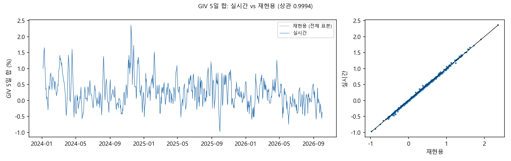
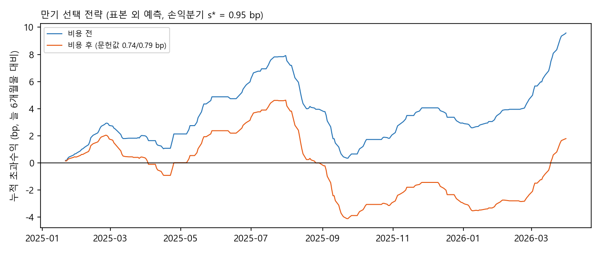
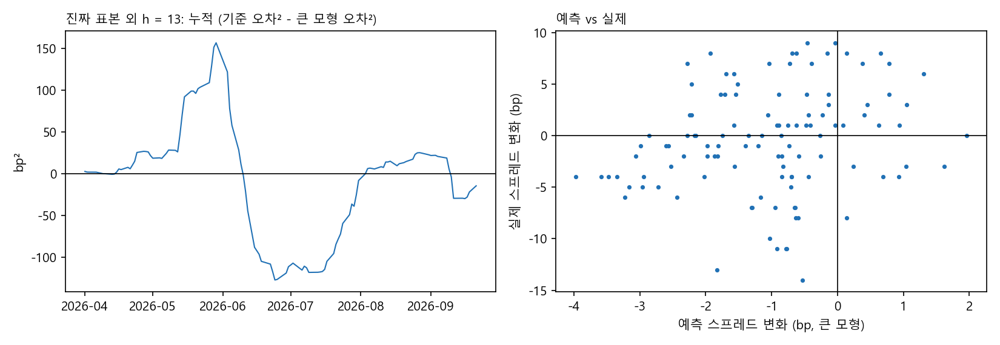

# 2부. 실시간 활용: 유입 신호로 금리를 예측하고 거래할 수 있는가

[← 1부 원 논문 재현](1부_원논문재현.md) · [전체 개요](../README.md) · 다음: [3부 GENIUS Act 주가 사건 연구 →](3부_GENIUS_주가사건연구.md)

---

## 질문

1부에서 유입 효과는 하루에 끝나지 않고 13거래일에 걸쳐 커졌습니다. 시장이 유입 정보를 천천히 반영한다면 다음과 같은 질문을 할 수 있습니다.

> **그날 알 수 있는 정보만으로 만든 신호가 이후 13일의 금리 변화를 예측하는가? 거래비용을 빼고도 이익을 낼 수 있는가?**

1부의 회귀는 전체 표본을 한 번에 써서 GIV를 만듭니다. 그래서 실제로 그날 거래하는 사람은 알 수 없었던 정보가 섞여 있습니다. 2부는 이 부분을 모두 걷어 냅니다.

## 원칙

1. **그날 알 수 있는 것만 씁니다.** GIV는 그날까지의 자료로만 매일 다시 계산합니다(실시간 GIV). DefiLlama 값이 확정되는 시각이 불확실해 하루를 늦춰 씁니다.
2. **판정 기준은 금리 결과를 보기 전에 정합니다.** `퀀트랩_거래전략_0.py`가 설계와 판정 기준을 CSV로 남기고, 저장할 때마다 시각을 기록 파일에 쌓습니다. 결과를 본 뒤 값을 바꾸면 기록에 남습니다.
3. **결과를 본 뒤 한 분석은 판정에 쓰지 않습니다.** "사후 분석"으로 따로 표시합니다.

## 설계

| 항목 | 내용 |
|---|---|
| 결과변수 | 3개월 − 6개월 금리 스프레드의 13 평일 변화 |
| 신호 | 실시간 GIV (2024년부터) |
| 판정 표본 | 2024년 ~ 2026년 3월 (496일) |
| 표본 외 예측 | 확장창으로 매일 다시 추정, 2025-01 ~ 2026-03 (271일) |
| 비교 기준 | 신호만 뺀 같은 모형 (Clark & West 2007) |
| 거래 전략 | 3개월물과 6개월물 중 신호가 유리하다고 하는 쪽을 보유 (만기 선택) |
| 거래비용 | 딜러 간 호가 차이 (Fleming 2003) |

스프레드는 원 논문 3.2절이 쓴 것(3개월 − 6개월)과 같습니다. 3개월 금리 하나만 보면 6개월물과 함께 움직인 몫(금리 전반의 움직임)이 섞이는데, 스프레드에서는 이 몫이 빠집니다.

### 판정 단계 (A → D 순서로, 앞 단계를 통과해야 다음 단계 의미가 있음)

| 판정 | 질문 | 기준 |
|---|---|---|
| A 검정력 | 효과가 있다면 이 자료로 잡을 수 있는가 | 1부 효과 크기를 가정했을 때의 검정력 |
| B 표본 내 | 신호와 이후 스프레드 변화 사이에 관계가 있는가 | 계수 음수, 5% 유의 |
| C 표본 외 | 예측이 되는가 | 표본 외 R² > 0 (신호 없는 모형보다 예측 오차가 작음), Clark-West 검정 유의 |
| D 경제적 의미 | 돈이 되는가 | 비용 후 초과수익 > 0, 손익분기 호가 차이 > 문헌 비용 |

---

## 결과

### 실시간 GIV는 1부 GIV와 거의 같음

| 점검 | 값 |
|---|---|
| 1부 GIV와의 상관 (전체 716일) | 0.9994 |
| 절대 차이 중앙값 / 최대 | 0.0047 / 0.099 |
| 1단계 F (실시간, 논문 표본) | 103.3 |

미래 정보를 걷어 내도 신호가 거의 바뀌지 않습니다. 실패한다면 신호 자체가 아니라 신호와 금리의 관계 쪽 문제입니다.

### 판정 요약

| 판정 | 결과 | 판정 |
|---|---|---|
| A 검정력 | 70.8% | 조건부 진행 |
| B 표본 내 | 신호 1표준편차당 **−1.05bp**, p 0.049, R² 0.067 | 성립 |
| C 표본 외 | 표본 외 R² **−2.07%**, Clark-West t 0.70 (p 0.243) | **성립 안 함** |
| D 경제적 의미 | 비용 후 누적 1.78bp (연 1.44bp), 손익분기 호가 차이 0.951bp > 0.79bp | 형식상 성립, **신호 기여 없음** |

### B 표본 내: 관계는 있다

h = 13에서 신호 1표준편차당 −1.05bp(p 0.049)입니다. 신호가 크면 이후 3개월 금리가 6개월 금리보다 상대적으로 내려간다는 뜻이고, 방향은 1부와 같습니다.

| h | 계수 (1SD, bp) | p |
|---|---|---|
| 10 | −0.88 | 0.049 |
| 13 (판정) | **−1.05** | **0.049** |
| 20 | −1.07 | 0.109 |
| 25 | −1.41 | 0.059 |

같은 신호로 3개월 금리 하나만 보면(보조) 계수는 음수지만 어떤 h에서도 유의하지 않습니다(h = 13에서 p 0.43).

### C 표본 외: 예측은 안 된다

> **표본 외 R²란?** 일반 R²(0 ~ 1)와 다릅니다. 매일 그날까지의 자료로만 모형을 다시 맞춰 다음 13일을 예측하고, 그 예측 오차를 **신호를 뺀 같은 모형**의 예측 오차와 비교합니다.
>
> 표본 외 R² = 1 − (신호 넣은 모형의 평균제곱오차 ÷ 신호 뺀 모형의 평균제곱오차)
>
> 신호가 예측에 도움이 되면 양수, 오히려 방해가 되면 **음수**가 됩니다(Campbell & Thompson 2008). Clark-West 검정은 신호를 넣으면 추정할 계수가 하나 늘어나서 생기는 불리함을 보정해, 두 모형의 예측력을 공정하게 비교하는 검정입니다.

신호를 넣은 모형의 예측 오차가 신호를 뺀 모형보다 오히려 2.07% 큽니다(표본 외 R² −2.07%). 표본 내에서 본 관계가, 그날까지의 자료만 쓰는 실시간 예측에서는 도움이 되지 않았다는 뜻입니다. 보조 신호로 바꿔도 마찬가지입니다.

| 비교 | 표본 외 R² | Clark-West t |
|---|---|---|
| ① GIV (판정) | −2.07% | 0.70 |
| ② 유입 전체 | −2.36% | −0.07 |
| ③ GIV + 유입 vs GIV | −1.17% | −0.45 |

### D 경제적 의미: 이익은 났지만 신호 덕이 아니다

만기 선택 전략은 비용 후에도 이익(누적 1.78bp)을 냈고, 손익분기 호가 차이(0.951bp)도 문헌 비용(0.79bp)보다 컸습니다. 형식상으로는 성립입니다.

하지만 **신호대로 갈아탄 날의 평균 초과수익(0.666bp)이 매일 무조건 갈아탔을 때(0.675bp)와 같습니다.** 이익은 신호의 타이밍이 아니라, 이 기간에 3개월물이 6개월물보다 유리했던 기간구조에서 나왔습니다.

### 강건성 (미리 정한 목록)

| 점검 | B 계수 (1SD) | B p | C 표본 외 R² | C CW t |
|---|---|---|---|---|
| 기준 | −1.05bp | 0.049 | −2.07% | 0.70 |
| ① 위약 검정 (가짜 신호) | −0.20bp | 0.668 | | |
| ② FOMC 창 제외 | −1.09bp | 0.071 | −0.69% | 1.08 |
| ③ 부채한도 기간 제외 | −1.00bp | 0.088 | −6.50% | −0.28 |
| ④ h = 10 | −0.88bp | 0.049 | −3.09% | 0.15 |
| ④ h = 20 | −1.07bp | 0.109 | −0.59% | 0.71 |
| ④ h = 25 | −1.41bp | 0.059 | −3.81% | 0.45 |

- 위약 검정은 통과했습니다. 가짜 신호로는 관계가 나오지 않습니다.
- 표본 내 계수의 크기는 어느 점검에서도 −0.9 ~ −1.4bp로 비슷합니다.
- 표본 외 R²는 모든 점검에서 음수입니다.

### 사후 분석 1: 신호 시작 시점 (판정에 쓰지 않음)

신호를 2024년이 아니라 2023년 7월부터 쓰면 결과가 달라지는지 봤습니다.

| 시작 | 관측치 | 검정력 | B 계수 (1SD), p | C 표본 외 R², CW t | 신호 타이밍 기여 |
|---|---|---|---|---|---|
| 2024년 (주 분석) | 496 | 70.8% | −1.05bp, 0.049 | −2.07%, 0.70 | −0.009bp |
| 2023-07 (사후) | 613 | 77.9% | −1.05bp, 0.022 | −3.38%, 0.50 | +0.012bp |

표본을 늘리면 표본 내 관계는 더 뚜렷해지지만, 표본 외 예측과 거래 결과는 그대로입니다. 참고로 분기별 1단계 F는 2023년 1·2분기에 0.97, 0.04로 10에 못 미치고, 3분기부터 10을 넘습니다(12.9, 32.6, 14.9).

### 사후 분석 2: 진짜 표본 외 (설계 이후에 생긴 자료)

설계를 고정한 뒤 새로 쌓인 2026-04-01 ~ 2026-10-08(112일)로 같은 모형을 돌렸습니다.

| 항목 | 진짜 표본 외 | 4·5단계 | 같은 방향 |
|---|---|---|---|
| 표본 외 R² | −0.52% | −2.07% | ✓ |
| Clark-West t | 0.38 | 0.70 | ✓ |
| 전략 타이밍 (갈아탄 날 − 모든 날) | +0.197bp | −0.009bp | ✗ |

새 자료에서도 예측력은 없습니다.

---

## 2부 결론

**스테이블코인 유입과 단기 스프레드의 관계는 표본 내에서는 있지만, 실시간 예측과 거래로 이어지지 않습니다.** 원인으로 볼 수 있는 것은 세 가지입니다.

1. **효과가 작습니다.** 표본 내 회귀에서도 신호가 스프레드 움직임의 약 7%만 설명합니다(일반 R² 0.067).
2. **표본이 짧습니다.** 신호를 쓸 수 있는 자료가 2024년부터라 표본 외 예측이 약 15개월입니다.
3. **관계가 시기마다 흔들립니다.**

"시장이 유입 정보를 이용 가능할 만큼 늦게 반영하지는 않는다"는 뜻으로도 읽을 수 있습니다.

## 한계

- **짧은 표본:** 판정 표본 496일, 표본 외 예측 약 15개월
- **비용 가정:** 거래비용은 1996 ~ 2000년 딜러 간 호가(Fleming 2003)입니다. 실제 고객 비용은 더 클 수 있습니다.
- **하나의 예측 기간:** 판정은 h = 13 하나로만 했습니다.
- 사후 분석(신호 시작 시점, 보조 신호, 진짜 표본 외)은 결과를 본 뒤 한 분석이라 판정에 쓰지 않았습니다.

---

## 자료

1부의 자료를 그대로 씁니다([1부 자료](1부_원논문재현.md#자료)). 추가로 필요한 자료는 없습니다.

## 코드 (실행 순서)

| 코드 | 하는 일 | 판정 |
|---|---|---|
| [`퀀트랩_거래전략_0.py`](../코드/퀀트랩_거래전략_0.py) | 설계 확정 (결과를 보기 전에 판정 기준을 파일로 남김) | |
| [`퀀트랩_거래전략_1.py`](../코드/퀀트랩_거래전략_1.py) | 실시간 GIV (그날까지의 자료로만 다시 계산) | |
| [`퀀트랩_거래전략_2.py`](../코드/퀀트랩_거래전략_2.py) | 검정력 점검 | A |
| [`퀀트랩_거래전략_3.py`](../코드/퀀트랩_거래전략_3.py) | 표본 내 예측 회귀 | B |
| [`퀀트랩_거래전략_4.py`](../코드/퀀트랩_거래전략_4.py) | 표본 외 예측 | C |
| [`퀀트랩_거래전략_5.py`](../코드/퀀트랩_거래전략_5.py) | 만기 선택 전략 백테스트 | D |
| [`퀀트랩_거래전략_6.py`](../코드/퀀트랩_거래전략_6.py) | 강건성 점검 | |
| [`퀀트랩_거래전략_6-1.py`](../코드/퀀트랩_거래전략_6-1.py) | 사후 분석: 신호 시작 시점 | |
| [`퀀트랩_거래전략_7.py`](../코드/퀀트랩_거래전략_7.py) | 사후 분석: 진짜 표본 외 (2026년 4 ~ 10월) | |

## 참고문헌

- Clark, T. E. and K. D. West (2007). Approximately normal tests for equal predictive accuracy in nested models. Journal of Econometrics 138(1)
- Campbell, J. Y. and S. B. Thompson (2008). Predicting excess stock returns out of sample. Review of Financial Studies 21(4)
- Goyal, A. and I. Welch (2008). A comprehensive look at the empirical performance of equity premium prediction. Review of Financial Studies 21(4)
- Fleming, M. J. (2003). Measuring Treasury market liquidity. FRBNY Economic Policy Review 9(3)
- Acosta, M., A. Ajello, M. Bauer, F. Loria and S. Miranda-Agrippino (2025). Financial market effects of FOMC communication. SF Fed Working Paper 2025-30
