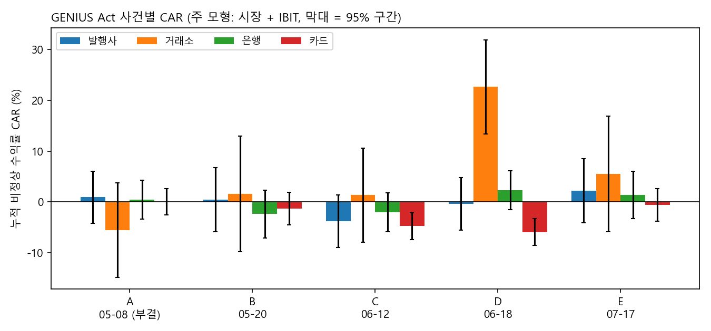
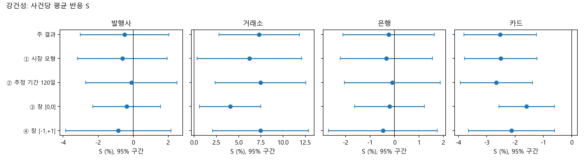

# 3부. GENIUS Act 주가 사건 연구: 법안 소식에 누가 오르고 누가 내렸는가

[← 2부 실시간 예측과 거래](2부_실시간예측과거래.md) · [전체 개요](../README.md) · 다음: [4부 GENIUS Act 국채 사건 연구 →](4부_GENIUS_국채사건연구.md)

---

## 질문

미국 스테이블코인법 **GENIUS Act**(S.1582)는 2025년 5 ~ 7월에 의회를 통과해 7월 18일에 서명되었습니다.

> **법이 한 걸음씩 나아가는 날들에 스테이블코인 발행사, 거래소, 은행, 카드 네트워크의 주가는 어떻게 반응했는가?**

1·2부는 스테이블코인이 국채시장에 미치는 영향을 봤습니다. 3부는 같은 산업을 제도 쪽에서 보고, 시장이 이 법을 누구에게 득이고 누구에게 손해라고 받아들였는지 확인합니다.

## 원칙

2부와 같습니다. 사건, 종목, 모형, 판정 기준을 모두 **사건 창의 주가를 보기 전에** `퀀트랩_사건연구_0.py`에 고정했습니다. 연구자가 유리한 사건만 고르지 않도록, **의회 기록에 남은 모든 본회의 표결과 서명**을 사건으로 씁니다.

---

## 설계

### 사건: 의회 기록 전체 (표결 7개 + 서명 1개)

| 번호 | 날짜 (미 동부) | 시각 | 내용 | 결과 |
|---|---|---|---|---|
| 1 | 2025-05-08 | 14:26 | 상원 토론종결 | **부결** |
| 2 | 2025-05-19 | 21:29 | 상원 토론종결 재투표 | 가결 |
| 3 | 2025-05-21 | 12:18 | 상원 심의 개시 | 가결 |
| 4 | 2025-06-12 | 14:43 | 상원 법안 토론종결 | 가결 |
| 5 | 2025-06-17 | 17:50 | 상원 통과 | 가결 |
| 6 | 2025-07-16 | 23:04 | 하원 심의 규칙 | 가결 |
| 7 | 2025-07-17 | 15:54 | 하원 통과 | 가결 |
| 8 | 2025-07-18 | (기록 없음) | 대통령 서명 | 서명 |

표결 시각은 의회 기록의 UTC를 미국 동부 시각(UTC−4)으로 바꾼 것입니다. 기록은 govinfo의 S.1582 법안 상태 기록(BILLSTATUS)입니다.

> **7/15 하원 부결 표결은 왜 없는가:** 2025년 7월 15일 하원에서 이 법을 다룰 심의 규칙 관련 표결이 196 대 223으로 부결됐습니다. 하지만 이 표결은 S.1582 기록에는 올라 있지 않습니다. 7/15 기록은 규칙위원회가 심의 규칙(H.Res. 580)을 보고한 것뿐이에요. 그래서 "기록의 모든 표결" 원칙에 따라 원사건에 넣지 않았습니다. 같은 날 저녁 대통령이 반대 의원들과 합의했다고 밝혔고, 그 소식은 사건 E 바로 전날(7/16)에 시장에 반영됐습니다.

### 0일과 사건 창

- **0일 규칙:** 장중(동부 9:30 ~ 16:00) 소식이면 그날, 장 마감 뒤 소식이면 다음 거래일이 0일입니다. 시각 기록이 없는 서명은 그날을 0일로 봅니다.
- **사건 창:** [0, +1], 즉 0일과 다음 거래일입니다. 마감 직전 소식이 다음 날로 넘어가는 것까지 잡습니다.
- **묶음 규칙:** 창이 겹치는 원사건은 하나로 묶습니다. 같은 날의 반응을 두 번 세지 않기 위해서입니다.

그 결과 사건은 5개가 됩니다.

| 사건 | 원사건 | 창 | 방향 |
|---|---|---|---|
| A | 1 (부결) | 2025-05-08 ~ 05-09 | −1 (나쁜 소식) |
| B | 2, 3 | 2025-05-20 ~ 05-22 | +1 |
| C | 4 | 2025-06-12 ~ 06-13 | +1 |
| D | 5 (상원 통과) | 2025-06-18 ~ 06-20 | +1 |
| E | 6, 7, 8 (하원 통과·서명) | 2025-07-17 ~ 07-21 | +1 |

### 종목 그룹

| 그룹 | 종목 | 고른 근거 | 예상 방향 |
|---|---|---|---|
| 발행사 | PYPL | 원 논문의 7개 코인 중 PYUSD (PayPal 브랜드) | + |
| 거래소 | COIN | Circle S-1: Coinbase가 USDC 준비금 잔여 수익의 50%를 받음 | + |
| 은행 | KBE, KRE | 예금 유출 우려 (미 재무부 2025-04 보고서의 최대 $6.6조 언급) | − |
| 카드 | V, MA | 스테이블코인 결제는 경쟁자이자 사업 기회 | 미리 정하지 않음 |
| 참고 | CRCL | USDC 발행사 Circle. 2025-06-05 상장이라 판정에 쓰지 않음 | |

은행은 개별 은행 대신, 정해진 규칙으로 묶인 은행 ETF를 썼습니다(KBE 은행 전반, KRE 지역은행).

**판정 기준 (그룹별)**

| 그룹 | 성립 기준 |
|---|---|
| 발행사, 거래소 | S > 0이고 5%에서 유의 |
| 은행 | S < 0이고 5%에서 유의 |
| 카드 | 방향을 정하지 않음. 유의하면 방향만 기록 |

### 모형과 검정

- **추정 기간:** 2024-04-24 ~ 2025-04-23 (250거래일). 사건 A의 11거래일 전에 끝나 사건 소식이 섞이지 않습니다. 다섯 사건 모두 이 기간 하나를 씁니다(뒤 사건의 추정에 앞 사건 소식이 섞이지 않게). 이 기간에는 **2025년 4월 관세 발표로 시장이 크게 흔들린 시기**가 들어 있어, 강건성에서 추정 기간을 120일로 바꿔 봅니다.
- **비정상 수익률:** 실제 수익률 − (a + b × 시장 + c × IBIT). 시장은 CRSP 가치가중 지수(배당 포함)입니다. IBIT(iShares 비트코인 현물 ETF)는 코인 시장 전체가 오른 날을 법 효과로 착각하지 않도록 넣었습니다. 비트코인 자체 가격 대신 IBIT를 쓴 이유는, 주식처럼 동부 16:00 종가라 주가와 시간이 맞고 CRSP에 있기 때문입니다(2024년 1월 상장).
- **그룹 포트폴리오:** 그룹마다 동일가중 포트폴리오 하나로 검정합니다. 모든 종목이 같은 날 사건을 맞기 때문에 종목을 따로 세면 유의성이 부풀려집니다(MacKinlay 1997).
- **판정값 S:** 사건 A ~ E의 (방향 × CAR) 평균입니다. 부결인 A는 부호를 뒤집어 "법이 한 걸음 나아갈 때의 평균 반응"으로 맞춥니다.
- **검정력:** 사건 창을 보기 전에, 추정 기간 잔차만으로 최소 검출 효과(= 2.8 × 표준오차, Bloom 1995)를 계산합니다.

---

## 결과

### 검정력 (사건 창을 보기 전)

| 그룹 | 시장 베타 | IBIT 베타 | R² | 최소 검출 효과 |
|---|---|---|---|---|
| 발행사 | 1.06 | 0.10 | 0.38 | 3.6% |
| 거래소 | 1.41 | 0.90 | 0.61 | 6.5% |
| 은행 | 1.02 | 0.08 | 0.50 | 2.7% |
| 카드 | 0.78 | −0.01 | 0.48 | 1.8% |

사건이 5개뿐이라, 사건당 평균 반응이 이보다 작으면 이 자료로 가려내기 어렵습니다.

### 주 판정: Coinbase는 오르고 Visa·Mastercard는 내림

| 그룹 | S | t | p | 최소 검출 효과 | 판정 |
|---|---|---|---|---|---|
| 발행사 (PYPL) | −0.49% | −0.38 | 0.705 | 3.6% | 성립 안 함 (판단 불가) |
| 거래소 (COIN) | **+7.31%** | 3.16 | 0.002 | 6.5% | **성립** |
| 은행 (KBE, KRE) | −0.24% | −0.25 | 0.800 | 2.7% | 성립 안 함 (판단 불가) |
| 카드 (V, MA) | **−2.52%** | −3.86 | <0.001 | 1.8% | **유의 (− 방향)** |

네 그룹 모두 **부결 사건 A의 CAR이 B ~ E 평균과 반대 부호**였습니다. 나쁜 소식과 좋은 소식에 반대로 반응했다는 뜻입니다.

| 그룹 | A의 CAR | B ~ E 평균 CAR |
|---|---|---|
| 발행사 | +0.92% | −0.38% |
| 거래소 | −5.51% | +7.76% |
| 은행 | +0.46% | −0.19% |
| 카드 | +0.04% | −3.14% |

### 사건별 CAR: 반응이 어느 날에 몰려 있는가

| 그룹 | A (부결, 5/8) | B (5/20) | C (6/12) | D (6/18) | E (7/17) |
|---|---|---|---|---|---|
| 발행사 | +0.92 | +0.46 | −3.80 | −0.38 | +2.20 |
| 거래소 | −5.51 | +1.56 | +1.35 | **+22.63** | +5.50 |
| 은행 | +0.46 | −2.38 | −2.02 | +2.29 | +1.36 |
| 카드 | +0.04 | −1.32 | **−4.74** | **−5.91** | −0.61 |

(단위 %, 부호를 뒤집기 전의 CAR, 굵은 글씨 = 5% 유의)

거래소의 반응은 **D 하루**, 카드의 반응은 **C와 D 이틀**에 몰려 있습니다. 그런데 이 두 날은 모두 다른 뉴스와 겹칩니다.

- **C (6/12 ~ 6/13):** 6/13에 월스트리트저널이 "월마트·아마존이 자체 스테이블코인을 검토한다"고 보도했습니다. 카드 네트워크에는 직접적인 악재입니다.
- **D (6/18 ~ 6/20):** 0일 6/18이 FOMC 성명 발표일입니다.

### 강건성 (미리 정한 네 가지)

| 그룹 | 주 결과 | ① 시장 모형 | ② 추정 기간 120일 | ③ 창 [0,0] | ④ 창 [−1,+1] |
|---|---|---|---|---|---|
| 발행사 | −0.49 | −0.61 | −0.10 | −0.38 | −0.85 |
| 거래소 | **+7.31** | **+6.20** | **+7.45** | **+4.05** | **+7.46** |
| 은행 | −0.24 | −0.33 | −0.09 | −0.20 | −0.47 |
| 카드 | **−2.52** | **−2.51** | **−2.66** | **−1.59** | **−2.13** |

(단위 %, 굵은 글씨 = 5% 유의)

모든 그룹이 네 가지 점검 모두에서 부호가 같았고, Coinbase와 카드는 모든 점검에서 5%에서 유의했습니다.

### 사후 분석: 사건 빼 보기 (판정에 쓰지 않음)

3·4단계 결과를 본 뒤, 위의 두 가지(카드 C 창의 WSJ 보도, 거래소의 D 하루 +22.6%) 때문에 추가한 분석입니다. 결론 문장의 강도를 정하는 데만 쓰고, 판정은 바꾸지 않습니다.

| 뺀 사건 | 거래소 S (p) | 카드 S (p) |
|---|---|---|
| 없음 | +7.31% (0.002) | −2.52% (<0.001) |
| A | +7.76% (0.004) | −3.14% (<0.001) |
| B | +8.75% (0.001) | −2.82% (<0.001) |
| C | +8.80% (0.001) | −1.97% (0.009) |
| **D** | **+3.48% (0.189)** | −1.68% (0.025) |
| E | +7.76% (0.002) | −3.00% (<0.001) |
| **C와 D 함께** | | **−0.66% (0.460)** |

- **Coinbase**는 상원 통과(사건 D)를 빼면 유의하지 않습니다. 유의성은 주로 그 하루에서 나옵니다.
- **카드**는 사건을 하나씩 빼면 계속 유의하지만, **다른 뉴스와 겹친 C와 D를 함께 빼면 −0.66%(p 0.46)로 유의하지 않습니다.** "C와 D를 함께 빼기"는 빼는 이유가 사건 창 밖의 뉴스로 정해지는 조합 하나만 본 것이고, 여러 조합을 골라 보지 않았습니다.
- 사건 D의 0일(2025-06-18)이 **FOMC 성명 발표일과 겹친다는 점**은 이 점검 중에 발견했습니다. 그래서 4부와 5부 설계에서는 D를 판정에서 뺐습니다.

### 참고: Circle (CRCL)

| 사건 | 시장 조정 CAR |
|---|---|
| C | +17.0% |
| D | +54.4% |
| E | −8.1% |

2025년 6월 5일에 상장해 추정 기간이 없고, 상장 직후 급등과 섞여 있어 참고로만 봅니다. 추정 기간이 없으므로 모형 대신 시장 수익률만 뺀 **시장 조정 수익률**(Circle 수익률 − 시장 수익률)을 썼고, 상장 뒤의 사건 C·D·E만 계산했습니다.

---

## 3부 결론

미리 정한 판정으로는 **거래소(Coinbase)는 법안 진전에 올랐고(성립), 카드 네트워크는 내렸습니다(유의, − 방향).** 네 그룹 모두 부결 소식에는 반대로 반응했습니다.

다만 두 결과 모두 **다른 뉴스와 겹친 날에 반응이 몰려 있습니다.** Coinbase는 FOMC와 겹친 상원 통과일(D) 하루에, 카드는 WSJ의 월마트·아마존 보도가 나온 C와 FOMC 날인 D 이틀에 기대고 있어요. 이 날들을 빼면 둘 다 유의하지 않습니다. 그래서 "시장이 이 법을 거래소에는 호재로, 카드에는 악재로 받아들였다"는 해석은 **방향은 일관되지만, 법안 소식만의 효과라고 단정하기는 어렵다**는 단서를 붙여 읽어야 합니다.

은행 예금 유출 우려는 주가에 드러나지 않았지만, 사건당 2.7%보다 작은 반응까지 배제할 수는 없습니다.

## 한계

- **사건 수:** 사건이 5개뿐이라 검정력이 제한됩니다. PayPal은 사건당 3.6%, 은행은 2.7%보다 작은 반응을 가려낼 수 없습니다.
- **동시 뉴스:** 사건 D는 FOMC와, 사건 C는 WSJ의 월마트·아마존 스테이블코인 보도와 겹칩니다. 유의한 두 결과(거래소, 카드)가 모두 이 날들에 몰려 있습니다(사후 점검).
- **다중 비교:** 그룹이 4개라 하나쯤은 우연히 유의할 수 있습니다.
- **추정 기간:** 2025년 4월 관세 발표 시기가 들어 있습니다(120일 강건성에서도 결과는 같음).
- **Circle:** 추정 기간이 없어 판정에 쓰지 않았습니다.
- **설계 전에 본 자료:** 설계 전에 자료가 있는지 확인하려고 COIN·CRCL의 2025년 6 ~ 12월 일별 가격 파일을 열어 봤습니다. 비정상 수익률 계산이나 해석은 하지 않았고, 판정 기준은 그 뒤에 정했습니다(설계 기록).

---

## 자료

| 자료 | 출처 | 저장 이름 |
|---|---|---|
| 8종목·ETF 일별 주식 자료 | WRDS CRSP Stock - Version 2, Daily Stock File (**구독 필요**) | `사건연구_CRSP_일별.csv` |
| 가치가중 시장지수 | WRDS CRSP Stock - Version 2, Daily Stock Market Indexes (**구독 필요**) | `사건연구_CRSP_시장지수.csv` |
| 법안 일정 | 미 의회 기록 (govinfo, S.1582) | `퀀트랩_사건연구_0.py` 설계표에 직접 적음 |

## 코드 (실행 순서)

| 코드 | 하는 일 |
|---|---|
| [`퀀트랩_사건연구_0.py`](../코드/퀀트랩_사건연구_0.py) | 설계 확정 (결과를 보기 전에 사건과 판정 기준을 파일로 남김) |
| [`퀀트랩_사건연구_1.py`](../코드/퀀트랩_사건연구_1.py) | CRSP 자료 정리, 사건 창과 추정 기간 확정 |
| [`퀀트랩_사건연구_2.py`](../코드/퀀트랩_사건연구_2.py) | 검정력 (사건 창을 보기 전 최소 검출 효과) |
| [`퀀트랩_사건연구_3.py`](../코드/퀀트랩_사건연구_3.py) | 본 분석: 사건별 CAR과 주 판정 |
| [`퀀트랩_사건연구_4.py`](../코드/퀀트랩_사건연구_4.py) | 강건성 점검 + Circle(CRCL) 참고 |
| [`퀀트랩_사건연구_5.py`](../코드/퀀트랩_사건연구_5.py) | 사후 분석: 사건 하나씩 빼 보기, 카드 C·D 함께 빼기 |

## 참고문헌

- MacKinlay, A. C. (1997). Event studies in economics and finance. Journal of Economic Literature 35(1)
- Bloom, H. S. (1995). Minimum detectable effects: A simple way to report the statistical power of experimental designs. Evaluation Review 19(5)
