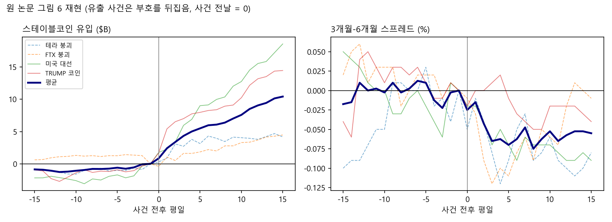
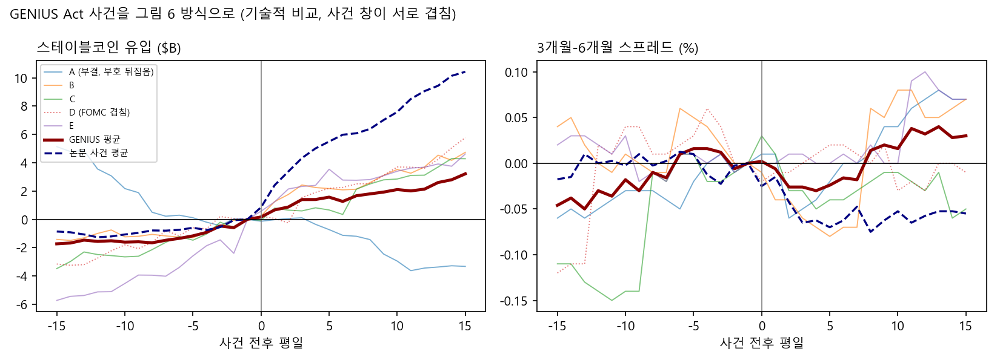
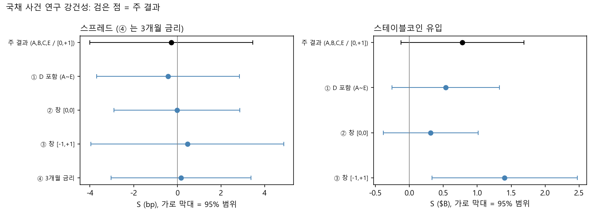

# 4부. GENIUS Act 국채 사건 연구: 법안 소식에 단기국채 스프레드와 유입이 반응했는가

[← 3부 GENIUS Act 주가 사건 연구](3부_GENIUS_주가사건연구.md) · [전체 개요](../README.md) · 다음: [5부 유입 베타 →](5부_유입베타.md)

---

## 질문

> **GENIUS Act가 의회를 통과해 가는 날들에 3개월 − 6개월 국채 스프레드와 스테이블코인 유입은 어떻게 반응했는가?**

3부에서 본 같은 법을 국채시장 쪽에서 봅니다.

### 원 논문과의 관계

원 논문 3.2절 그림 6은 코인 시장의 큰 사건 4개(테라 붕괴, FTX 붕괴, 미국 대선, TRUMP 코인) 전후의 유입과 스프레드를 보여 줍니다. 사건 뒤 유입이 늘고 스프레드가 좁아진다는 그림입니다.

원 논문은 GENIUS Act를 이 그림에서 **뺐습니다.** 근거는 "점진적이고 일부는 예상되었으며, 유입이 크지 않았다"는 것입니다(각주 25). 4부는 논문이 말로만 한 이 판단을 자료로 직접 확인합니다.

### 왜 스프레드인가

GENIUS Act는 발행사 준비금으로 쓰는 국채를 **만기 93일 이하**로 제한합니다(원 논문 각주 28). 3개월물(91일)은 해당하고 6개월물은 해당하지 않습니다. 이 법이 금리에 영향을 줬다면 두 금리의 차이에서 드러나야 합니다.

---

## 설계 (결과를 보기 전에 `퀀트랩_국채사건_0.py`에 고정)

4부는 두 층으로 나뉩니다.

| 층 | 내용 | 판정에 쓰는가 |
|---|---|---|
| 1층 | 원 논문 그림 6 재현 + 같은 방식으로 GENIUS 사건 그리기 | 재현 여부만 판정. GENIUS 그림은 기술적 비교 |
| 2층 | GENIUS 사건의 짧은 창 [0, +1] 검정 | 판정 |

GENIUS 사건은 간격이 짧습니다(A → B 8거래일, C → D 4거래일). 그래서 그림 6 방식의 ±15일 창은 서로 겹쳐 사건별로 구분할 수 없습니다. 판정은 2층의 짧은 창으로만 합니다.

### 자료

| 항목 | 내용 |
|---|---|
| 날짜 단위 | 평일 (국채 금리가 있는 날). 주말 유입은 다음 평일에 들어감 |
| 유입 | DefiLlama 7개 코인 합산 시가총액 ($B), 1부 확장 자료 |
| 유입 시점 | 평일 d의 유입 = DefiLlama d+1일 값. DefiLlama 일별 값은 00:00 UTC 기록이라, 미국 동부 d일 저녁(그날 금리 시각)에 가장 가까움 |
| 스프레드 | FRED DGS3MO − DGS6MO (bp), 1부 확장 자료 |

### 1층: 그림 6 재현 판정

- **사건:** 원 논문 그림 6 주석의 사건 4개. 유출 사건(테라, FTX)은 부호를 뒤집어 유입으로 맞춥니다.
- **창:** ±15 평일, 사건 전날을 0으로 놓고 누적 변화를 그립니다.
- **판정 (평균선, 모두 맞으면 재현됨):**
  - ⓐ +15일 누적 유입 > 0
  - ⓑ +15일 스프레드 변화 < 0
  - ⓒ 사건 전 변화 크기(−15일 → −1일)가 사건 후 변화 크기(−1일 → +15일)보다 작음 (유입·스프레드 각각)

원 논문에 숫자나 검정이 없어 방향 기준만 정했습니다.

### 2층: 짧은 창 검정

| 항목 | 내용 |
|---|---|
| 사건 | 3부와 같은 사건 A ~ E (`사건연구_사건창.csv`를 그대로 읽어 두 연구의 사건이 어긋나지 않음) |
| 판정 사건 | **A, B, C, E.** D는 0일이 FOMC 성명 발표일(2025-06-18)과 같아 금리 변화가 FOMC 몫과 섞임 → 강건성에서만 넣음 |
| 창 | [0, +1] |
| 측정 | 창 끝 날 값 − 창 시작 전날 값 (스프레드 bp, 유입 $B) |
| 평균 조정 | 비정상 변화 = 창 변화 − (추정 기간 하루 평균 변화 × 창 길이). 평소 꾸준히 늘던 유입(시장 성장) 몫을 뺌 |
| 추정 기간 | 2024-04-24 ~ 2025-04-23 (3부와 같음) |
| 검정 | t = 비정상 변화 ÷ (추정 기간 하루 변화 표준편차 × √창 길이) |
| 판정값 | S = 판정 사건의 (방향 × 비정상 변화) 평균 |

### 판정 기준과 해석표 (결과를 본 뒤 해석을 끼워 맞추지 않도록 미리 고정)

- **스프레드:** S < 0이고 5%에서 유의하면 성립
- **유입:** 방향을 미리 정하지 않음. 유의 여부와 방향만 기록

| 유입 | 스프레드 | 해석 |
|---|---|---|
| 유의하지 않음 | 유의하지 않음 | **논문 판단과 맞음** |
| 유의하지 않음 | 좁아짐 | 시장이 앞으로의 단기국채 수요를 미리 반영 |
| 늘어남 | 좁아짐 | 법안도 유입 충격으로 작동 (논문 판단과 다름) |
| 늘어남 | 유의하지 않음 | 유입이 금리로 이어지지 않음 (1부와 어긋남) |

---

## 결과

### 1층: 원 논문 그림 6은 재현됨

| 평균선 | 유입 | 스프레드 |
|---|---|---|
| −15일 (사건 전) | −0.86 $B | −1.75bp |
| +15일 (사건 후) | **+10.43 $B** | **−5.50bp** |

ⓐ 유입 +10.43 $B > 0, ⓑ 스프레드 −5.50bp < 0, ⓒ 사건 전 변화가 사건 후 변화보다 작음. 세 기준을 모두 충족해 **재현됨**으로 판정합니다. 사건 4개의 0일은 모두 논문 날짜 그대로입니다(그날 국채시장이 열려 있었음).

### 1층: GENIUS 사건을 같은 방식으로 그림 (기술적 비교, 판정에 쓰지 않음)

### 2층 검정력 (사건 창을 보기 전)

| 대상 | 하루 평균 변화 | 하루 변화 표준편차 | S 표준오차 | 최소 검출 효과 |
|---|---|---|---|---|
| 스프레드 | +0.02bp | 2.40bp | 1.89bp | 5.3bp |
| 유입 | +0.26 $B | 0.58 $B | 0.46 $B | 1.28 $B |
| 3개월 금리 (강건성) | −0.45bp | 2.06bp | 1.62bp | 4.5bp |

### 2층 주 판정: 스프레드도 유입도 반응하지 않음

| 대상 | S | t | p | 최소 검출 효과 | 판정 |
|---|---|---|---|---|---|
| 스프레드 | −0.28bp | −0.15 | 0.883 | 5.3bp | **성립 안 함** |
| 유입 | +0.78 $B | 1.71 | 0.089 | 1.28 $B | 유의하지 않음 |

해석표에 따르면 **유입 유의하지 않음 + 스프레드 유의하지 않음 → 원 논문이 이 법을 그림 6에서 뺀 판단과 맞습니다.**

사건별 비정상 변화:

| 사건 | 방향 | 스프레드 (bp) | t | 유입 ($B) | t |
|---|---|---|---|---|---|
| A | −1 | −1.04 | −0.31 | −0.49 | −0.59 |
| B | +1 | −4.06 | −0.98 | +0.99 | +0.98 |
| C | +1 | +0.96 | +0.28 | +0.28 | +0.35 |
| E | +1 | +0.94 | +0.23 | +1.38 | +1.37 |
| (D, 판정 제외) | +1 | −1.04 | −0.31 | −0.45 | −0.54 |

어느 사건도 혼자서 유의하지 않습니다.

### 강건성 (미리 정한 네 가지)

| 경우 | 스프레드 S (p) | 유입 S (p) | 창 안 FOMC |
|---|---|---|---|
| 주 결과 (A, B, C, E / [0, +1]) | −0.28bp (0.883) | +0.78 $B (0.089) | 없음 |
| ① D 포함 (A ~ E) | −0.43bp (0.795) | +0.54 $B (0.183) | 2025-06-18 |
| ② 창 [0, 0] | −0.02bp (0.989) | +0.32 $B (0.374) | 없음 |
| ③ 창 [−1, +1] | +0.46bp (0.838) | **+1.40 $B (0.010)** | 2025-05-07 |
| ④ 3개월 금리 (스프레드 대신) | +0.17bp (0.914) | | 없음 |

- 스프레드는 어떤 경우에도 유의하지 않고, ③ · ④에서는 부호도 바뀝니다.
- 유입은 ③ 창 [−1, +1]에서만 5%에서 유의합니다. 다만 이 창에는 사건 A 전날인 **2025-05-07 FOMC 성명**이 들어가고, 네 사건 중 가장 큰 몫이 사건 E(+3.52 $B, t 3.03)에서 나옵니다. 강건성은 미리 정한 대로 판정을 바꾸지 않고 기록만 합니다.

---

## 4부 결론

- 원 논문 그림 6(코인 사건 뒤 유입이 늘고 스프레드가 좁아짐)은 무료 자료로 **재현됩니다.**
- GENIUS Act 소식에는 스프레드도 유입도 짧은 창에서 유의하게 반응하지 않았습니다. **원 논문이 이 법을 "유입이 크지 않았다"며 뺀 판단과 맞습니다.**
- 3부에서 주가는 같은 날들에 크게 반응했습니다(Coinbase +7.3%, 카드 −2.5%). 주식시장은 이 법을 회사별 득실로 받아들였지만, 이 자료로 잡을 수 있는 크기에서는 그 소식이 그날 바로 스테이블코인 유입이나 단기국채 금리로 이어지지 않았습니다.

## 한계

- **검정력:** 스프레드는 사건당 평균 5.3bp, 유입은 1.28 $B보다 작은 반응을 가려낼 수 없습니다. "반응이 없었다"가 아니라 "이보다 큰 반응은 없었다"로 읽어야 합니다.
- **사건 수:** 판정 사건이 4개뿐입니다.
- **일별 근사:** 하루 변화끼리 독립이라고 보고 표준오차를 구했습니다.
- **FOMC:** D를 판정에서 뺐지만, 강건성 ③처럼 창을 넓히면 다른 FOMC 날짜가 들어옵니다.
- **알고 설계한 것:** 3부(주가) 결과와 원 논문 그림 6의 결과는 알고 설계했습니다. GENIUS 사건 창의 스프레드·유입 값은 설계 전에 보지 않았습니다(`국채사건_설계_기록.csv`).

---

## 자료

새로 받을 자료는 없습니다. 1부 확장 자료와 3부 사건 파일을 그대로 씁니다.

| 입력 파일 | 만드는 코드 |
|---|---|
| `확장_시장자료_원자료_일별.csv` (FRED 3개월·6개월 금리) | `퀀트랩_BIS_4-1.py` |
| `확장_합산시총_일별.csv` (DefiLlama 7개 코인 합산) | `퀀트랩_BIS_4-1.py` |
| `확장_통화정책충격_USMPD.xlsx` (FOMC 날짜 확인) | 직접 받음 ([1부 자료](1부_원논문재현.md#자료)) |
| `사건연구_사건창.csv`, `사건연구_추정기간.csv` | `퀀트랩_사건연구_1.py` |

## 코드 (실행 순서)

| 코드 | 하는 일 |
|---|---|
| [`퀀트랩_국채사건_0.py`](../코드/퀀트랩_국채사건_0.py) | 설계 확정 (결과를 보기 전에 설계와 판정 기준·해석표를 파일로 남김) |
| [`퀀트랩_국채사건_1.py`](../코드/퀀트랩_국채사건_1.py) | 자료 정리, 그림 6 사건의 0일, GENIUS 창이 국채 거래일인지, FOMC 겹침, 추정 기간 빈 값 확인 |
| [`퀀트랩_국채사건_2.py`](../코드/퀀트랩_국채사건_2.py) | 검정력 (추정 기간 자료만 사용) |
| [`퀀트랩_국채사건_3.py`](../코드/퀀트랩_국채사건_3.py) | 본 분석: 그림 6 재현, GENIUS 그림, 짧은 창 검정과 판정 |
| [`퀀트랩_국채사건_4.py`](../코드/퀀트랩_국채사건_4.py) | 강건성 네 가지 + 창 안 FOMC 확인 |

## 참고문헌

- Ahmed, R. and I. Aldasoro (2025). Stablecoins and safe asset prices. BIS Working Papers No 1270 (2026년 6월 개정판), 3.2절·그림 6·각주 25·각주 28
- MacKinlay, A. C. (1997). Event studies in economics and finance. Journal of Economic Literature 35(1)
- Bloom, H. S. (1995). Minimum detectable effects: A simple way to report the statistical power of experimental designs. Evaluation Review 19(5)
