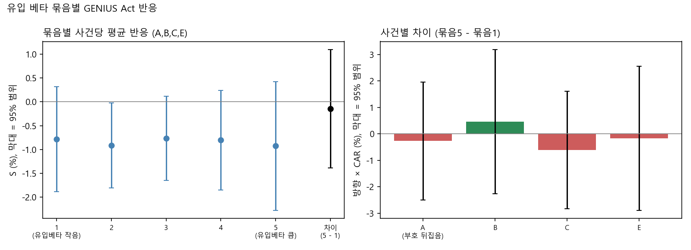
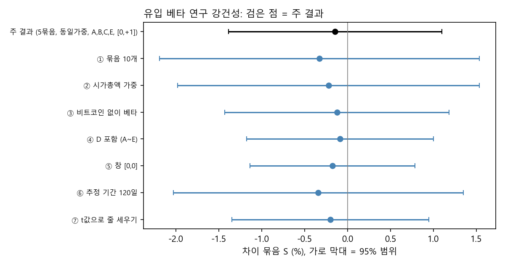
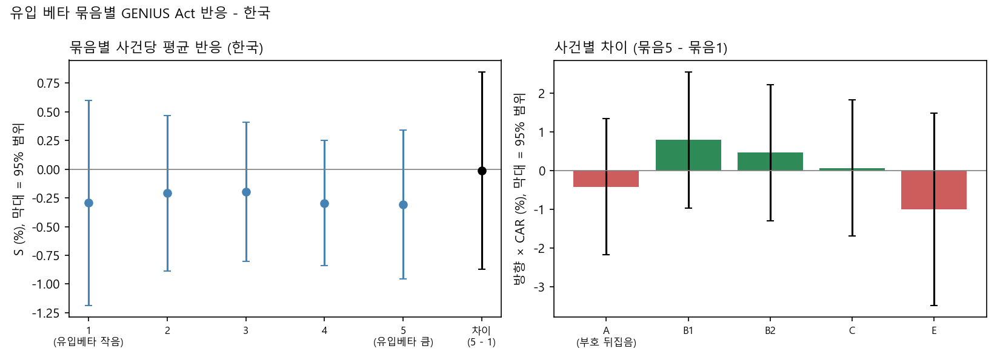
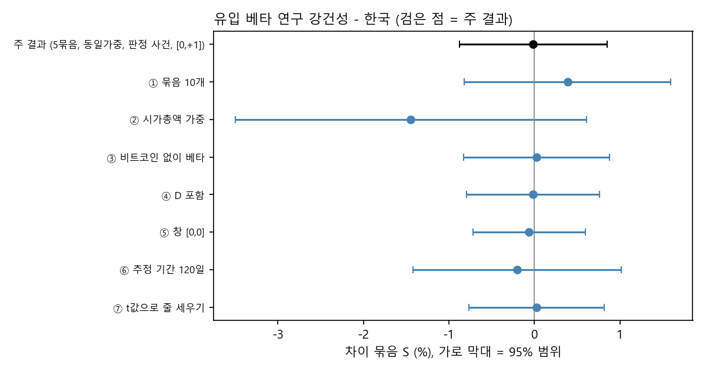

# 5부. 유입 베타: 평소 유입과 같이 움직이던 주식이 법안 소식에 더 크게 반응했는가

[← 4부 GENIUS Act 국채 사건 연구](4부_GENIUS_국채사건연구.md) · [전체 개요](../README.md)

---

## 질문

3부에서는 "득 보는 회사 / 손해 보는 회사"를 **생각으로** 골랐습니다(발행사, 거래소, 은행, 카드). 5부는 이것을 **자료로** 고릅니다.

> **법 소식 전 기간에 스테이블코인 유입과 같이 움직이던 정도(유입 베타)가 큰 주식 묶음이, 작은 묶음보다 GENIUS Act 소식에 더 크게 올랐는가?**

성립한다면 평소 자료만으로 법안의 수혜주를 미리 고를 수 있었다는 뜻입니다. 미국 전 종목으로 먼저 보고, 같은 설계를 한국(코스피·코스닥)에 다시 적용합니다.

### 앞 연구와의 연결

새로 정하는 것을 줄이려고 앞 연구의 값을 그대로 씁니다.

| 요소 | 가져온 곳 |
|---|---|
| 유입 자료 | 1부 (DefiLlama 7개 코인 합산 시가총액) |
| 비정상 수익률 모형, 추정 기간, 사건 | 3부 |
| 유입 날짜 규칙 (d+1), 판정 사건 A·B·C·E | 4부 |

---

## 설계 (결과를 보기 전에 `퀀트랩_유입베타_0.py`에 고정)

### 1단계: 종목 거르기 (미국)

| 조건 | 내용 | 근거 |
|---|---|---|
| 보통주 | SecurityType = EQTY, SecuritySubType = COM, ShareType = NS, USIncFlg = Y | CRSP Version 2 (옛 형식 SHRCD 10·11에 해당). 펀드·ETF·우선주·외국 법인 제외 |
| 거래소 | NYSE, AMEX, NASDAQ | CRSP Version 2 (옛 형식 EXCHCD 1·2·3) |
| 자료 충분 | 추정 기간 250일 중 수익률이 있는 날 200일 이상 | 베타를 안정적으로 재기 위함 |
| 주가 하한 | 추정 기간 마지막 날(2025-04-23) 주가 5달러 이상 | Jegadeesh & Titman (2001). 값싼 주식은 호가 단위 때문에 수익률 잡음이 큼 |

CRSP 전 종목 일별 자료(2024년 4월 ~ 2025년 12월)에서 단계마다 남은 종목 수는 다음과 같습니다(`퀀트랩_유입베타_1.py` 출력).

| 단계 | 남은 종목 |
|---|---|
| 보통주·거래소 조건 | 4,405 |
| 추정 기간 수익률 200일 이상 | 3,856 |
| 주가 5달러 이상 | **2,653** |

### 2단계: 유입 베타와 묶음

추정 기간(2024-04-24 ~ 2025-04-23, 3부와 같음) 동안 종목마다 다음 회귀를 합니다.

```
R_i = a + b·R_시장 + c·R_IBIT + d·유입 + e      → 유입 베타 = d
```

- **유입:** 합산 시가총액의 하루 변화($B)입니다. 추정 기간에 평균 +0.26 $B, 표준편차 0.57 $B로 4부 국채 연구의 자료와 같습니다.
- **IBIT를 같이 넣는 이유:** 추정 기간에 유입과 비트코인(IBIT) 수익률의 상관이 **+0.28**입니다. 비트코인이 오르는 날 스테이블코인 유입도 느는 경향이 있어서, IBIT를 빼면 "코인 시장 전체와 같이 움직이는 몫"이 유입 베타에 섞입니다. 그래서 함께 넣어 스테이블코인 유입 몫만 봅니다.
- **유입 베타의 단위:** 유입이 하루 $1B 늘 때 종목 수익률이 얼마나 더 움직이는지입니다(0.0064 = 0.64%p).
- **묶음:** 유입 베타 순서로 5개 묶음을 만듭니다(1 = 가장 작음, 5 = 가장 큼, Ang, Hodrick, Xing & Zhang 2006). 종목 하나의 베타는 잡음이 커서 묶음으로 보고, 한 번 정한 묶음은 사건 기간 내내 고정합니다.
- **가중:** 동일가중. 사건 기간에 상장 폐지된 종목은 그날부터 평균에서 빠집니다.

### 3단계: 사건 반응 (3부 방식 그대로)

- **비정상 수익률 모형:** R_묶음 = a + b·R_시장 + c·R_IBIT + e. 유입 항목은 넣지 않아 3부와 똑같은 기준으로 반응을 잽니다.
- **차이 묶음:** 매일의 (묶음 5 수익률 − 묶음 1 수익률). 두 묶음의 반응 차이를 수익률 하나로 만들어 바로 검정합니다.
- **사건:** A, B, C, E. 창 [0, +1]. D는 FOMC와 겹치고 3부 사후 점검에서 Coinbase 반응이 몰려 있던 사건이라 강건성에서만 넣습니다.

### 판정

| 항목 | 기준 |
|---|---|
| 판정값 | S = 판정 사건의 (방향 × CAR) 평균. 묶음 1 ~ 5와 차이 묶음 각각 |
| 판정 | **S_차이 > 0이고 5%에서 유의하면 성립** |
| 보조 (기록만) | 묶음 1 ~ 5의 S가 순서대로 커지는지 (묶음 번호와 S의 순위 상관) |
| 검정력 | 사건 창을 보기 전에 추정 기간 잔차로 최소 검출 효과 계산 |

### 강건성 (미리 정한 일곱 가지)

| 번호 | 바꾼 것 |
|---|---|
| ① | 묶음 10개 (차이 = 묶음 10 − 묶음 1) |
| ② | 시가총액 가중 (가중치 = 2025-04-23 시가총액, 고정) |
| ③ | 유입 베타를 IBIT 없이 추정 |
| ④ | D 포함 (A ~ E, 3부와 같은 사건) |
| ⑤ | 창 [0, 0] |
| ⑥ | 추정 기간 120일 |
| ⑦ | 유입 베타 대신 유입 베타의 t값으로 줄 세우기 |

⑦은 2단계에서 양 끝 묶음에 변동이 큰 종목이 몰린 것을 보고, **사건 창 결과를 보기 전에** 추가했습니다. 이 추가 이력은 `유입베타_설계_기록.csv`에 남아 있습니다.

---

## 결과: 미국

### 종목과 묶음

거른 뒤 **2,653개 종목**이 남았고, 묶음마다 530 ~ 531개입니다.

| 묶음 | 1 (작음) | 2 | 3 | 4 | 5 (큼) |
|---|---|---|---|---|---|
| 평균 유입 베타 | −0.0040 | −0.0011 | 0.0000 | +0.0013 | +0.0064 |
| 평균 IBIT 베타 | 0.052 | 0.023 | 0.028 | 0.031 | 0.057 |
| 평균 시장 베타 | 1.05 | 0.93 | 0.88 | 0.94 | 1.06 |
| 많은 업종 | 제약·바이오, 소프트웨어 | | 은행 | 은행 | 소프트웨어, 제약·바이오 |

**양 끝 묶음(1과 5)에 시장·비트코인 베타가 높은, 변동이 큰 종목(제약·바이오, 소프트웨어)이 몰렸습니다.** 유입 베타가 대부분 잡음이면, 많이 출렁이는 종목일수록 베타 추정치도 크게 출렁여 우연히 양 끝으로 가기 때문입니다. 이걸 보고 강건성 ⑦(t값으로 줄 세우기)을 추가했습니다.

3부 종목의 위치는 다음과 같습니다.

| 종목 | 묶음 | 유입 베타 t값 |
|---|---|---|
| COIN (Coinbase) | 5 | 1.58 |
| HOOD (Robinhood) | 5 | 2.38 |
| MSTR (Strategy) | 5 | 1.11 |
| V, MA, JPM | 4 | 1.04, 0.59, 1.10 |
| PYPL (PayPal) | 1 | −1.01 |

Coinbase가 위쪽 묶음에 들어간 것은 3부 결과를 알고 있어 짐작할 수 있었습니다. 다만 묶음 반응은 530개 종목의 평균이라 한 종목이 좌우하지 않습니다.

### 검정력 (사건 창을 보기 전)

| 묶음 | 하루 잔차 표준편차 | R² | 최소 검출 효과 |
|---|---|---|---|
| 1 | 0.71% | 0.77 | 1.56% |
| 3 | 0.57% | 0.79 | 1.26% |
| 5 | 0.87% | 0.74 | 1.92% |
| **차이** | 0.80% | 0.06 | **1.77%** |

### 주 판정: 성립 안 함

| 대상 | S | t | p | 최소 검출 효과 |
|---|---|---|---|---|
| 묶음 1 | −0.78% | −1.40 | 0.161 | 1.56% |
| 묶음 2 | −0.92% | −2.02 | 0.044 | 1.27% |
| 묶음 3 | −0.77% | −1.70 | 0.090 | 1.26% |
| 묶음 4 | −0.81% | −1.51 | 0.131 | 1.49% |
| 묶음 5 | −0.93% | −1.35 | 0.178 | 1.92% |
| **차이 (5 − 1)** | **−0.14%** | −0.23 | 0.820 | 1.77% |

- **판정: 성립 안 함.** 차이는 0에 가깝고 부호도 예상과 반대입니다. 95% 신뢰구간은 **−1.39% ~ +1.10%** 라서, "유입 베타가 큰 묶음이 사건당 1.1% 넘게 더 올랐다"고 보기는 어렵습니다.
- **보조:** 묶음 번호와 S의 순위 상관은 −0.50으로, 순서대로 커지지 않았습니다. 사건별 차이도 B만 법안 진전 방향(+)이고 A, C, E는 반대여서 방향이 섞입니다(아래 표, A는 부호를 뒤집어 읽음).
- 다섯 묶음 모두 S가 −0.8 ~ −0.9% 정도로 비슷했습니다(묶음 2만 5%에서 유의). 유입 베타와 상관없이 모든 묶음에 공통된 움직임으로 보입니다. 묶음은 동일가중이라 중소형주 비중이 크고 시장 지수는 대형주 중심이어서, 그 차이가 함께 잡혔을 수 있습니다. 이 공통 몫은 차이 묶음(5 − 1)에서는 빠집니다.

사건별 차이 묶음 CAR:

| 사건 | 방향 | CAR | t |
|---|---|---|---|
| A | −1 | +0.27% | 0.24 |
| B | +1 | +0.47% | 0.34 |
| C | +1 | −0.61% | −0.54 |
| E | +1 | −0.16% | −0.12 |



### 강건성: 일곱 가지 모두 같은 부호, 모두 유의하지 않음

| 경우 | S_차이 | p | 최소 검출 효과 |
|---|---|---|---|
| 주 결과 | −0.14% | 0.820 | 1.77% |
| ① 묶음 10개 | −0.33% | 0.730 | 2.65% |
| ② 시가총액 가중 | −0.22% | 0.805 | 2.50% |
| ③ IBIT 없이 베타 | −0.12% | 0.852 | 1.86% |
| ④ D 포함 | −0.09% | 0.875 | 1.55% |
| ⑤ 창 [0, 0] | −0.18% | 0.720 | 1.37% |
| ⑥ 추정 기간 120일 | −0.34% | 0.689 | 2.39% |
| ⑦ t값으로 줄 세우기 | −0.20% | 0.734 | 1.63% |

일곱 가지 모두 0 근처이고, 크기가 최소 검출 효과(1.4 ~ 2.6%)의 10분의 1 안팎입니다. 특히 ⑥ 추정 기간 120일은 맨 위·맨 아래 묶음의 종목이 주 결과와 **62 ~ 72%만 겹칠** 만큼 묶음 구성이 달라졌는데도 결과가 같았습니다(`퀀트랩_유입베타_4.py` 출력). ⑦ t값으로 줄을 세워 변동성 문제를 줄여도 마찬가지였습니다.



---

## 결과: 한국 확장

### 한국에서 따로 정한 것 (미국 결과를 본 뒤, 한국 자료로 아무것도 계산하기 전)

| 항목 | 내용 |
|---|---|
| 종목 | 코스피 + 코스닥, 상장 폐지 포함, 일반기업 보통주. K-OTC·코넥스·기간 전 상장 폐지 제외, 이름에 "스팩"이 들어간 기업인수목적회사 제외 |
| 수익률 | DataGuide 수정주가수익률 (현금배당 포함) |
| 거른 날 | 거래정지일, 하루 \|수익률\| > 30%인 날 (가격제한폭 ±30%를 넘는 상장 첫날·정리매매 등) |
| 시장 수익률 | 종목이 속한 시장의 지수 (코스피 / 코스닥) |
| 0일 규칙 | 의회 기록 시각(미국 동부)을 한국 시간으로 바꿔, 한국 장중(9:00 ~ 15:30)이면 그날, 장 밖이면 다음 한국 거래일 |
| IBIT 시점 | 한국 거래일 t에는 t보다 앞선 가장 최근 미국 거래일의 IBIT 수익률 (한국 장 마감 전에 이미 나온 정보 중 가장 최근 것) |
| 유입 시점 | DefiLlama 같은 날짜 값. 00:00 UTC = 한국 오전 9시로, 한국 장 마감과 가장 가까운 기록 (미국의 d+1과 같은 원칙) |
| 추정 기간 | 한국 거래일 250일 (2024-04-09 ~ 2025-04-21). 한국 기준 사건 A의 11거래일 전에 끝남 |
| 묶음 비정상 수익률 | 종목마다 "자기 시장 지수 + IBIT" 모형으로 비정상 수익률을 구해 묶음별로 평균. 종목마다 시장 지수가 달라 미국처럼 묶음 하나로 회귀할 수 없기 때문 |
| 주가 하한 | 없음. 주가 자체를 받지 않아 5달러 기준을 적용할 수 없음 (시가총액 가중 강건성이 대형주 위주로 보는 역할) |

### 한국 사건 창

| 사건 | 미국 사건 | 창 | 판정 |
|---|---|---|---|
| A | A | 2025-05-09 ~ 05-12 | ✓ |
| B1 | B (표결 2) | 2025-05-20 ~ 05-21 | ✓ |
| B2 | B (표결 3) | 2025-05-22 ~ 05-23 | ✓ |
| C | C | 2025-06-13 ~ 06-16 | ✓ |
| D | D | 2025-06-18 ~ 06-19 | 강건성만 |
| E | E | 2025-07-17 ~ 07-22 | ✓ |

미국의 사건 B를 이루는 두 표결이 한국 시간으로는 서로 다른 장(5/20, 5/22)에 반영되어 둘로 나뉩니다.

### 주 판정: 성립 안 함

DataGuide 코스피·코스닥 전 종목에서 단계마다 남은 종목 수는 다음과 같습니다(`퀀트랩_유입베타_한국_1.py` 출력). 거래정지일과 하루 변동이 ±30%를 넘는 날(상장 첫날, 정리매매 등) 108칸은 수익률에서 뺐습니다.

| 단계 | 남은 종목 |
|---|---|
| 코스피·코스닥 | 2,647 |
| 스팩 제외 | 2,560 |
| 추정 기간 수익률 200일 이상 | **2,338** |

묶음마다 467 ~ 468개입니다. 미국과 마찬가지로 유입 베타가 유의한(|t| > 2) 종목은 4.4%로 우연 수준이었고, **양 끝 묶음에 변동이 큰 코스닥 종목이 몰렸습니다**(코스닥 비율: 묶음1 79%, 묶음5 67%).

| 대상 | S | t | p | 최소 검출 효과 |
|---|---|---|---|---|
| 묶음 1 | −0.29% | −0.64 | 0.520 | 1.27% |
| 묶음 2 | −0.21% | −0.61 | 0.544 | 0.96% |
| 묶음 3 | −0.20% | −0.63 | 0.526 | 0.86% |
| 묶음 4 | −0.29% | −1.06 | 0.289 | 0.78% |
| 묶음 5 | −0.31% | −0.93 | 0.355 | 0.92% |
| **차이 (5 − 1)** | **−0.01%** | −0.03 | 0.977 | 1.22% |

- **판정: 성립 안 함.** 95% 신뢰구간은 **−0.87% ~ +0.85%** 입니다. 보조 순위 상관은 −0.60입니다.

| 사건 | 방향 | 차이 CAR | t |
|---|---|---|---|
| A | −1 | +0.41% | 0.46 |
| B1 | +1 | +0.80% | 0.89 |
| B2 | +1 | +0.47% | 0.53 |
| C | +1 | +0.07% | 0.08 |
| E | +1 | −0.99% | −0.79 |



### 강건성: 부호는 갈리고, 모두 유의하지 않음

| 경우 | S_차이 | p | 최소 검출 효과 |
|---|---|---|---|
| 주 결과 | −0.01% | 0.977 | 1.22% |
| ① 묶음 10개 | +0.39% | 0.529 | 1.72% |
| ② 시가총액 가중 | −1.44% | 0.168 | 2.92% |
| ③ IBIT 없이 베타 | +0.03% | 0.952 | 1.21% |
| ④ D 포함 | −0.02% | 0.969 | 1.10% |
| ⑤ 창 [0, 0] | −0.06% | 0.853 | 0.94% |
| ⑥ 추정 기간 120일 | −0.20% | 0.746 | 1.72% |
| ⑦ t값으로 줄 세우기 | +0.02% | 0.951 | 1.13% |

주 결과가 0에 매우 가까워, 일곱 가지 중 세 가지(①③⑦)에서 부호가 바뀝니다. 어느 경우도 5%에서 유의하지 않습니다.



---

## 5부 결론

- **미국과 한국 모두, 유입 베타가 큰 묶음이 작은 묶음보다 GENIUS Act 소식에 더 크게 오르지 않았습니다.** 미국은 강건성 일곱 가지 모두 같은 결론이고, 한국은 차이가 0 근처에서 오갑니다.
- 3부에서 생각으로 고른 회사들(Coinbase, 카드)은 유의하게 반응했지만(다만 다른 뉴스와 겹친 날에 몰림, [3부](3부_GENIUS_주가사건연구.md) 참고), "평소 유입과 같이 움직이던 정도"라는 통계적 기준으로 고른 묶음에서는 그런 반응이 잡히지 않았습니다. 다만 종목별 유입 베타 자체가 잡음이 커서(아래 한계), 이 기준이 수혜주를 가려내지 못한 것인지 수혜가 없었던 것인지는 구분하기 어렵습니다.
- 2부(유입 신호로 금리를 예측할 수 없음)와 함께 보면, 스테이블코인 유입은 국채 금리에도 주가에도 **실시간으로 이용할 만한 신호가 되지 못했습니다.**

## 한계

- **검정력:** 차이 묶음 기준으로 미국은 사건당 1.77%, 한국은 1.22%보다 작은 차이를 가려낼 수 없습니다.
- **유입 베타의 잡음:** 유입 베타의 t값이 |2|를 넘는 종목은 미국 118개 / 2,653개, 한국 103개 / 2,338개로 둘 다 4.4%입니다. 우연히 나올 비율(약 5%)과 같아서, 시장과 비트코인을 빼고 나면 스테이블코인 유입과 따로 움직이는 주식은 거의 없다고 봐야 합니다. 그래서 묶음이 진짜 유입 민감도를 얼마나 가려냈는지는 불확실합니다. 실제로 양 끝 묶음에 변동이 큰 종목이 몰렸고, 그래서 ⑦ t값 줄 세우기를 추가했습니다.
- **사건 수:** 판정 사건이 미국 4개, 한국 5개입니다.
- **알고 설계한 것:** 3부와 4부 결과를 알고 설계했습니다. 한국 설계는 미국 결과를 본 뒤 정했지만, 한국 자료로 계산하기 전입니다.
- **한국 시장 구분:** 시장 구분은 2025-12-30 현재 값 하나라, 기간 중 시장을 옮긴 종목은 현재 시장 기준입니다.
- **한국 지수 수익률에는 배당이 없습니다**(종목은 배당 포함). 하루 단위 차이는 작고, 사건 창(5 ~ 7월)에는 배당이 거의 없습니다.

---

## 자료

| 자료 | 출처 | 저장 이름 |
|---|---|---|
| 미국 전 종목 일별 (2024-04-01 ~ 2025-12-31) | WRDS CRSP Stock - Version 2, Daily Stock File (**구독 필요**) | `유입베타_CRSP_전종목_일별.csv` |
| 한국 종목 일별 (수익률, 시가총액, 거래정지, 시장, 업종) | FnGuide DataGuide (**구독 필요**) | `유입베타_DataGuide_한국_일별.xlsx` |
| 코스피·코스닥 지수 일별 | FnGuide DataGuide (**구독 필요**) | `유입베타_DataGuide_지수_일별.xlsx` |
| 시장·IBIT 수익률, 사건 창, 추정 기간 | 3부 결과 | `사건연구_수익률_일별.csv` 등 (`퀀트랩_사건연구_1.py`) |
| 합산 시가총액 | 1부 결과 | `확장_합산시총_일별.csv` (`퀀트랩_BIS_4-1.py`) |

한국 파일에서 쓰는 DataGuide 아이템:

| 코드 | 아이템 |
|---|---|
| S410007900 | 수정주가수익률 (현금배당포함) (%) |
| S410001250 | 시가총액 (백만원) |
| S410002600 | 거래정지구분 |
| CP10000300 | 시장구분 |
| CP10001090 | 거래소 업종 (세부분류) |

## 코드 (실행 순서)

| 코드 | 하는 일 |
|---|---|
| [`퀀트랩_유입베타_0.py`](../코드/퀀트랩_유입베타_0.py) | 설계 확정 (미국 + 한국 확장 설계) |
| [`퀀트랩_유입베타_1.py`](../코드/퀀트랩_유입베타_1.py) | 미국: CRSP 자료 정리, 종목 거르기, 요인(시장·IBIT·유입) 붙이기 |
| [`퀀트랩_유입베타_2.py`](../코드/퀀트랩_유입베타_2.py) | 미국: 유입 베타, 5개 묶음, 검정력 (사건 창을 보기 전) |
| [`퀀트랩_유입베타_3.py`](../코드/퀀트랩_유입베타_3.py) | 미국: 묶음별 사건 반응과 판정 |
| [`퀀트랩_유입베타_4.py`](../코드/퀀트랩_유입베타_4.py) | 미국: 강건성 일곱 가지 |
| [`퀀트랩_유입베타_한국_1.py`](../코드/퀀트랩_유입베타_한국_1.py) | 한국: 자료 정리, 한국 0일·사건 창, 유입 베타, 묶음, 검정력 |
| [`퀀트랩_유입베타_한국_2.py`](../코드/퀀트랩_유입베타_한국_2.py) | 한국: 판정 + 강건성 일곱 가지 |

## 참고문헌

- Ang, A., R. J. Hodrick, Y. Xing and X. Zhang (2006). The cross-section of volatility and expected returns. Journal of Finance 61(1)
- Jegadeesh, N. and S. Titman (2001). Profitability of momentum strategies: An evaluation of alternative explanations. Journal of Finance 56(2)
- MacKinlay, A. C. (1997). Event studies in economics and finance. Journal of Economic Literature 35(1)
- Bloom, H. S. (1995). Minimum detectable effects: A simple way to report the statistical power of experimental designs. Evaluation Review 19(5)
